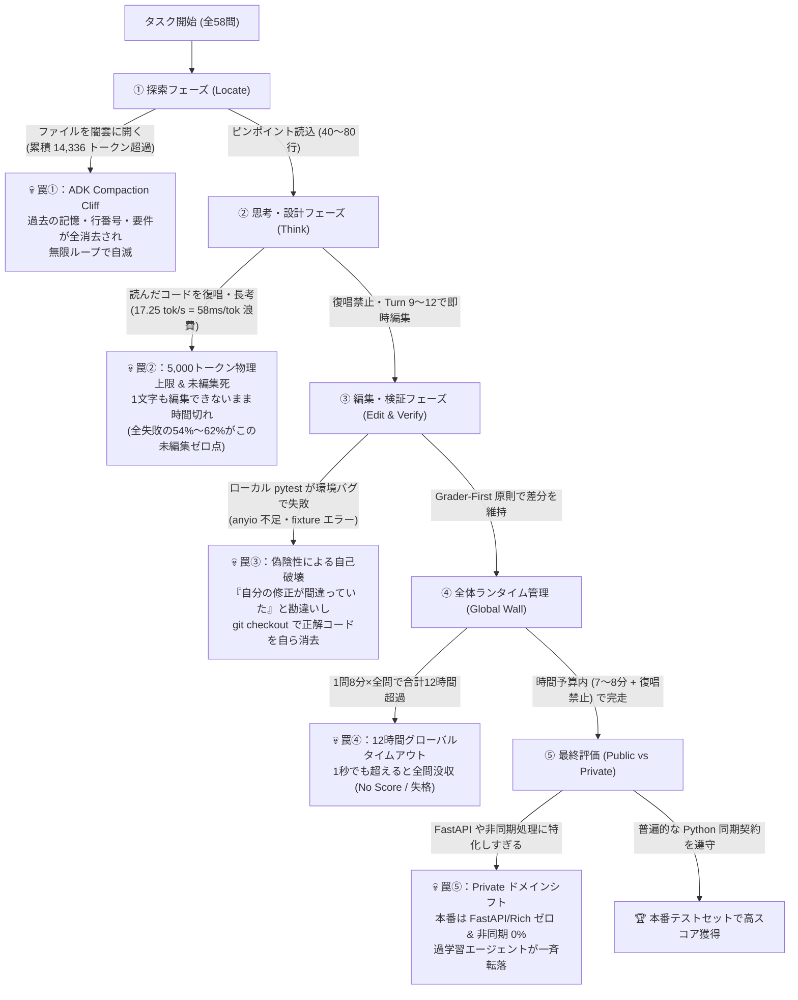
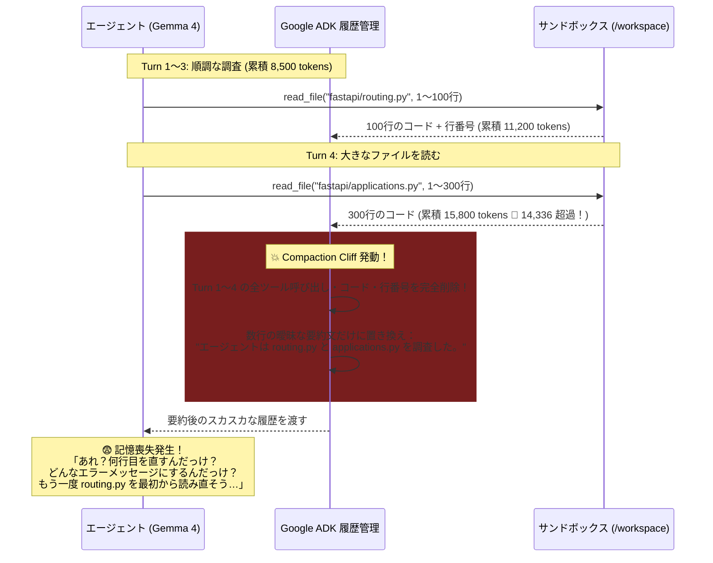
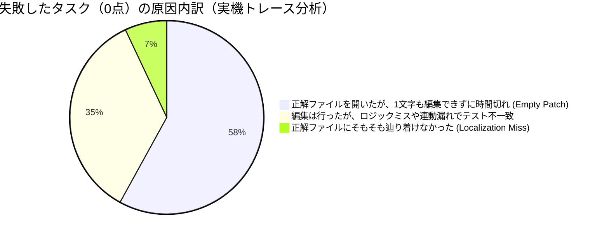
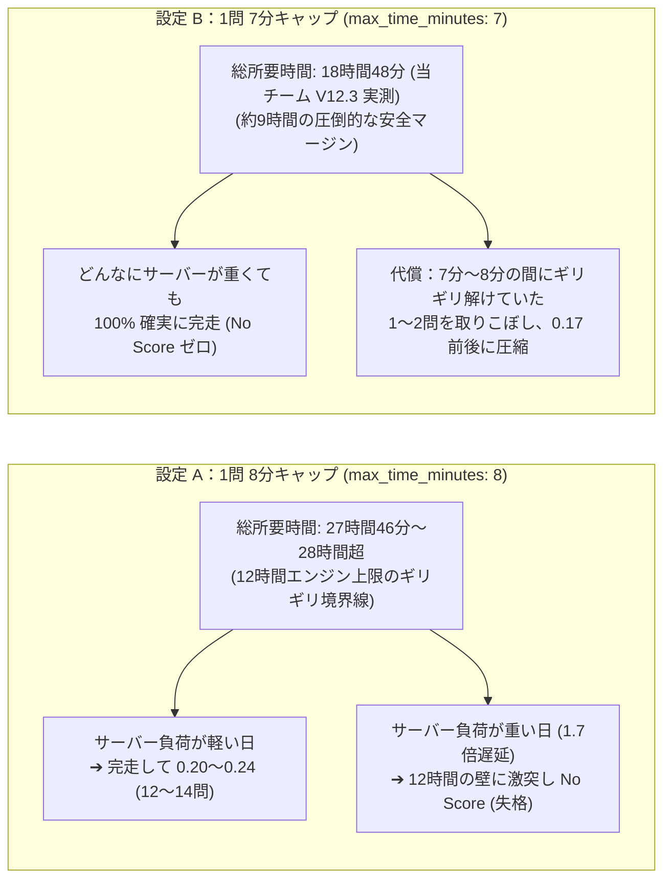
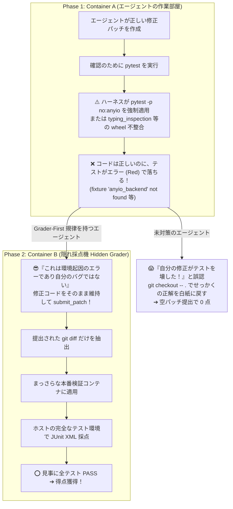

# Architectural Pillars & Hard Constraints（重要技術仕様・アーキテクチャの柱とハード制約）完全図解ガイド

本ドキュメントは、Kaggle「Google - The Gemma 4 Developer Agent Competition」において、リバースエンジニアリング・実機計測・公式ハーネス解析・および過去 12 回の提出実験によって特定された **「5 つの物理的・構造的制約（Hard Constraints）」と、それを突破するための「設計の柱（Architectural Pillars）」** を図解入りで徹底解説する技術仕様書です。

---

## 全体俯瞰：なぜ普通の AI エージェントはこのコンペで 0 点になるのか？

本コンペでは、エージェントが「問題を読み ➔ ファイルを探し ➔ コードを書き換え ➔ 提出する」という一見単純な流れの中に、**5 つの致命的な落とし穴（トラップ）** が仕掛けられています。



以下、5 つの柱と制約のそれぞれについて、**「物理的メカニズム」「実測データ」「図解」「具体的な対策とトレードオフ」** を詳しく解説します。

---

## 第 1 の柱と制約：【記憶の崖】ADK `14,336-Token` Compaction Cliff

### 1.1 何が起きるのか？（物理的メカニズム）
本コンペの公式評価ハーネス（`swegemma`）は、内部で **Google Agent Development Kit (ADK)** を使用してエージェントの会話履歴を管理しています。  
この ADK には、コンテキストウィンドウ（最大 32,768 トークン）の溢れを防ぐため、**累積トークン数が `14,336 トークン` を超えた瞬間に発動する「自動要約（Compaction）機能」** がハードコードされています。

一見すると便利な機能に見えますが、コーディングエージェントにとっては **「突然の記憶喪失（インスタント・アムネジア）」** を引き起こす最大の凶器となります。



### 1.2 実測データで見る破壊力
ローカル環境でのトレース解析により、1 タスク中にこの Compaction（履歴圧縮）が何回発動したかによって、タスク解決率が以下のように激減することが判明しています。

| Compaction 発動回数 | タスク解決率 (Resolution Rate) | エージェントの挙動 |
| :---: | :---: | :--- |
| **0 回（14k 未満を維持）** | **47.7%** | 問題文の厳密な変数名・行番号を最後まで記憶し、正確に `edit_file` を成功させる。 |
| **1 回発動** | **26.4%** *(約半減)* | 序盤に読んだファイルの行番号やインデントを忘れ、`edit_file` の一致エラーを連発する。 |
| **2 回以上発動** | **7.1%** *(壊滅)* | 完全に記憶喪失の無限ループに入り、同じファイルを何度も `read_file` して時間切れになる。 |

### 1.3 対策と設計上のトレードオフ
* **実装対策**:
  1. `read_file` は丸ごと読まず、必ず `start_line` と `end_line` を指定して **1 回あたり 40〜80 行** に抑える。
  2. `run_command` で `git grep` や `pytest` を実行する際は、必ず `| head -n 25` や `-x -q` を付けて出力行数を切り詰める。
* **判明したリスク（V11 での教訓）**:
  * 14k トークンを恐れるあまり、システムプロンプト自体を極端に削りすぎると（V11）、今度はエージェントに伝えるべき「仕様抽出の手順」まで失われ、基礎スコアが落ちる（`0.20 ➔ 0.15`）という副作用が確認されました。プロンプトは削りすぎず（約 3,000 トークン程度）、**「ツールが返す出力サイズ」だけを絞る** のが正しい制御です。

---

## 第 2 の柱と制約：【物理速度の定数】`17.25 tok/s` と「未編集ゼロ点（Empty Patch）」の罠

### 2.1 ハードウェアの物理限界（300秒 ＝ 5,000トークンの法則）
Kaggle の評価環境は **NVIDIA L4 GPU × 4 基（計 96GB VRAM）** 上で、vLLM（Tensor Parallel = 4）を用いて量子化モデル `gemma-4-31b-it-qat-w4a16-ct` を動かしています。

実機計測により、この環境のトークン生成速度（Output Generation Speed）は **`17.25 tokens / sec`（1トークンあたり約 58 ミリ秒）** という物理定数で固定されていることが分かっています。

```
【時間予算の物理方程式】
  1問の制限時間（7〜8分 = 420〜480秒）
  − コンテナ起動・ツール実行・Prefill（入力読込）時間（約 120〜180秒）
  ＝ 純粋にモデルが文字を出力できる時間：約 300 秒

  300 秒 × 17.25 tokens/秒 ＝ 約 5,175 トークン（上限）
```

つまり、エージェントは **1 問あたり「思考（Thinking）＋ ツール呼び出し引数 ＋ 通常の返答」をすべて合わせて、約 5,000 トークンしか文字を書けない** という極めて厳しい物理制約下に置かれています。

### 2.2 「コードの復唱（オウム返し）」が命取りになる理由
もしエージェントが `read_file` で 80 行のコードを読んだ直後に、
> *「なるほど、以下のコードを確認しました：`def _encode_files(...): ...`（80行をそのまま引用・要約）」*

と出力してしまうと、それだけで **1,000〜1,200 トークン（＝約 60〜70 秒）** を消費します。たった 3 回これをやると 3 分半が消滅し、コードを 1 文字も直せないまま制限時間を迎えます。

### 2.3 コミュニティ実機計測で判明した真の敵：「Empty Patch（未編集死）」
さらに重要な事実として、コミュニティの実機トレース検証（`busyaprime` 氏 68 ラン、`prvsiyan` 氏 96 ラン）および当チームの V12.3 検証により、以下の衝撃的な内訳が判明しています。



* **重要な真実**:
  * 解けなかったタスクの **93%（15問中14問）は、すでに 3 ターン目までに正解ファイルを正しく開いています**。
  * しかし、全タスクの **54%〜62% が「最後まで `edit_file` を成功させられず、パッチサイズ 0（Empty Patch）のまま時間切れ」** になっています。
* **対策（No Restatement & Early Edit Milestone）**:
  1. **復唱禁止**: `Do NOT restate, echo, or summarize code or files you just read. Read silently, then act immediately.` をプロンプトに明記し、58ms/tok の浪費を止める。
  2. **初回編集マイルストーン**: 「完璧に理解できるまで読む」のではなく、**「遅くとも Call 9〜12 までに、最も可能性の高い箇所に必ず 1 回目の編集（Best-guess edit）を入れよ。未編集のツリーは 100% 0点だが、間違った編集は後から直せる」** と強制する。

---

## 第 3 の柱と制約：【時間の壁】12-Hour Global Timeout Wall（7分 vs 8分のジレンマ）

### 3.1 1秒の超過で全てが0点になる「VOIDの崖」
Kaggle のコンペティション環境には、全タスク（裏の検証セット含む約 100〜120 問相当の負荷）を通しで実行する際の **全体制限時間（エンジン実行上限 12 時間 ＝ 43,200 秒、キュー待ち込みで約 28 時間）** が存在します。

この全体制限を **1 秒でも超過すると、それまでに何問正解していても途中集計は行われず、即座に `Notebook Exceeded Allowed Runtime（No Score / 失格）` となります**。

### 3.2 「8分キャップ」と「7分キャップ」の物理的トレードオフ
本日確認した公開検証ノートブック（`alexust` 氏：*"One Bundle, Three Outcomes: 0.24, 0.17, No Score"*）と、当チームの V12.1（8分）vs V12.3（7分）の比較により、1問あたりの制限時間設定のメカニズムが完全に解明されました。



* **当チームの戦略的解（V9.1 のアプローチ）**:
  * 単純に `eval_config.yaml` を 7 分に下げると安全にはなりますが、後半（7〜8分目）で粘って解いていた 1〜2 問を失います。
  * そこで **V9.1（現在採点中）** では、枠自体は **「8分」を維持して後半の粘りを残しつつ、プロンプト側の「復唱禁止（No Restatement）」によって 1 問あたりの実質所要時間を短縮し、8分のまま 12 時間の壁から遠ざかる** というハイブリッドな解決策を採っています。

---

## 第 4 の柱と制約：【採点環境の罠】Grader-First 原則（二段階コンテナと偽陰性トラップ）

### 4.1 なぜ「正しいコードを書いたのに手元のテストが落ちる」のか？
`swegemma` ハーネスは、セキュリティと公平性を担保するため、**「エージェントが作業するコンテナ（Container A）」と「本番採点を行うコンテナ（Container B）」を完全に分離** しています。



### 4.2 採点機（Hidden Grader）の厳密な合格条件（4 Clauses）
2026年9月25日のルール改定以降、`scripts/metric.py` による合格判定は以下の **4 条件すべてを同時に満たすこと** と定義されています：
1. `pytest` の終了コードが `0` であること（`exit_code == 0`）。
2. JUnit XML レポートが正常に生成・パースできること。
3. `passed_tests > 0` かつ `failures == 0` かつ `errors == 0` であること。
4. **必須テストノード（Required test nodes）のすべてが明示的に `PASSED` であること（`SKIPPED` は不合格扱い）**。

* **重要な結論（Grader-First Invariant）**:
  * 採点機は「Container A でエージェントがテストを走らせたか」「Container A でテストが通ったか」を **1 ビットも見ていません**。見ているのは提出された `git diff` だけです。
  * したがって、**「手元のテストが環境エラー（fixture 不足や ImportError）で落ちても、問題文の仕様通りにソースコードを直したなら、絶対に `git checkout` で巻き戻さずそのまま提出せよ」** という Grader-First 原則が不可欠となります。

---

## 第 5 の柱と制約：【問題の構造】Dead Tasks・Localization の真実・Private ドメインシフト

### 5.1 解法が存在しない「デッドタスク（Dead Tasks）」の存在
上記の厳格な採点ルール（特に「条件 4：SKIPPED は不合格」）により、公開データセット内には **「人間の開発者が書いた公式の正解パッチ（Gold Patch）をそのまま当てても 0 点になる問題」** が存在します。

| タスク ID | なぜ正解パッチでも 0 点になるのか？（原因） | 結果 |
| :--- | :--- | :---: |
| **`fastapi_14186`** | テスト内に `@needs_pydanticv1` と `@needs_pydanticv2` の両方のデコレータが存在。1つのコンテナ環境には Pydantic v1 か v2 の片方しか入らないため、もう片方のテストが必ず `SKIPPED` となり、条件 4 違反で弾かれる。 | **0 点確定** |
| **`rich_3486`** | テスト内に `sys.version_info < (3, 11)` と `>= (3, 11)` の条件分岐があり、どの Python バージョンで動かしても片方が必ず `SKIPPED` となる。 | **0 点確定** |

* **教訓**: 公開ボードの満点は `1.00`（58/58）ではなく、実質分母は 56 問以下です。解けない問題に時間を浪費せず、解ける問題を確実に拾う設計が必要です。

### 5.2 Localization（ファイル探索）の真実：なぜ `findfile` でも 0.17 だったのか？
当チームは V12.1（Pathspec 除外）および V12.3（TF-IDF ランク付け `findfile`）にて、初期のファイル探索精度を極限まで高める実験を行いました。
* ローカルベンチマーク（N=63）では、探索ミス率が **54.0%（V11）➔ 28.6%（V12.1）➔ 3.2%（V12.3）** へと劇的に改善しました。
* しかし、Kaggle 本番の Public LB スコアは **V12.1 も V12.3 も同じ `0.17`（10問）** でした。

**なぜか？**
1. 前述の通り、Gemma 4 は `findfile` のような特別なスクリプトを使わなくても、通常の `git grep` で **93% の確率で 3 ターン目までに正解ファイルに辿り着けていた** からです。
2. 逆に、`findfile` の長い Python ワンライナーを Call 1 で実行させたことで 1 ターンを消費し、さらに V12 系のプロンプトで `:!docs_src` や `:!tests` を強制除外したことで、「テストコードを 1 つ読んで入出力の型を確認する」「`docs_src` 内のチュートリアルコードを修正する（全タスクの約 11.6%）」という行動が封じられ、プラスマイナスが相殺されてしまったためです。

### 5.3 【最重要】本番（Private Leaderboard）の巨大なドメインシフト
コンペホスト（Ryan Holbrook 氏）が Forum（Topic 745998 & Topic 747248）で明言した、**最終順位（Private LB）に関する 3 つの公式確定事実** です。

```
【ホスト公式発表による Private（本番テストセット）の仕様】
  事実 A：公開練習用のリポジトリ（FastAPI, Rich, Requests, HTTPX）は、
          本番テストセット（Private）には「1 つも含まれない」。
  事実 B：公開セットには環境バグで通らない問題があったが、
          本番テストセットのタスクは「全問すべて解決可能（100% Solvable）」である。
  事実 C：本番テストセットには `async def`（非同期関数）を修正するタスクは「0 件」であり、
          リポジトリ全体でも非同期関数は 1.8% 未満（実質 100% 同期 Python コード）である。
```

* **戦略的結論**:
  * FastAPI 専用のルールや特定ディレクトリ名（`fastapi/` や `rich/`）に依存したハックは、本番 Private では **100% 無意味（むしろノイズ）** になります。
  * 最終的な勝敗を分けるのは、未知の Python リポジトリに対しても全く同じように機能する **「普遍的な仕様抽出」「3〜5行のユニークコンテキストによる確実な `edit_file`」「復唱禁止による時間保護」「Grader-First による自己破壊防止」** の 4 点です。

---

## まとめ：5 つの柱と制約の早見表

| 柱・制約 | 物理的定数・境界値 | 未対策時の死因 | 当チームの対策（V9.1 / V12.3） |
| :--- | :---: | :--- | :--- |
| **① 記憶の崖**<br>(Compaction Cliff) | **累積 14,336 tokens** | 過去のツール結果と行番号が消去され、無限ループで時間切れ | `read_file` を 40〜80 行に制限、コマンド出力を `head -20` で抑制 |
| **② 生成速度の壁**<br>(Hardware Speed) | **17.25 tok/s**<br>(上限 ~5,000 tok) | 読んだコードの復唱で時間を浪費し、未編集（Empty Patch 58%）で終了 | **復唱禁止（No Restatement）** と Call 9〜12 での強制初回編集 |
| **③ 全体時間の壁**<br>(Global Timeout) | **全体 12 時間**<br>(実測 ~28h 上限) | 1問8分設定の遅延重なりで 12h を1秒超え、全問没収（No Score） | 復唱禁止による実質時間短縮（V9.1）、または 7分キャップ保険（V12.3: 18.8h完走） |
| **④ 採点環境の罠**<br>(Grader-First) | **Container A ≠ B**<br>(JUnit 4条件) | ローカル pytest の環境エラーに騙され、`git checkout` で正解を自ら消す | **Grader-First 規律**：環境・fixture エラーを無視しソース diff を死守 |
| **⑤ 本番ドメインシフト**<br>(Private Shift) | **既存リポ 0%**<br>**非同期関数 0%** | FastAPI 特化ハックや複雑な探索スクリプトが未知リポで機能不全を起こす | 特定リポ依存を排し、V9 の普遍的な仕様抽出＋ユニークブロック編集へ回帰 |
