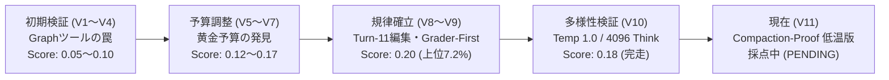
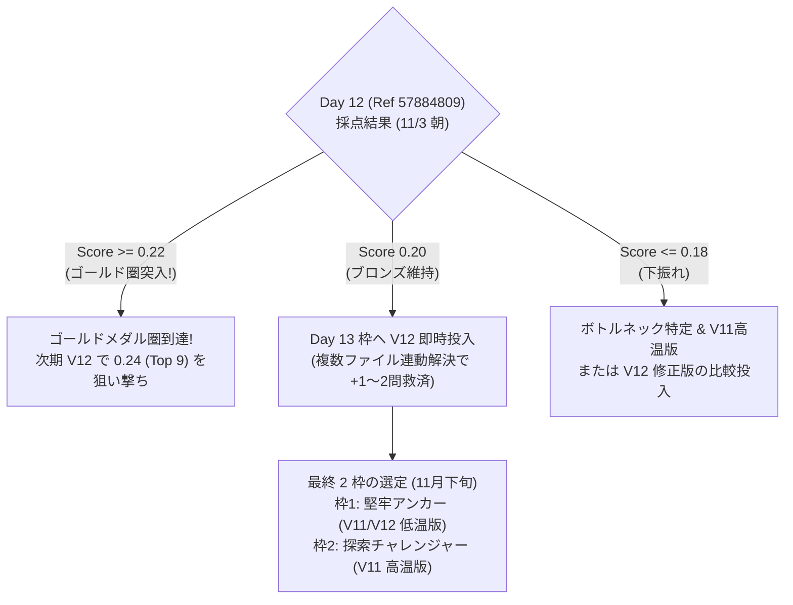

# Google - The Gemma 4 Developer Agent Competition
## コンペ概要と現在の取り組み・戦略総括ドキュメント

---

## 0. 【超入門】中学生でもわかる！この大会ってなに？（3分まとめ）

### ① どんな競技なの？
**「プログラミングの宿題を、AIロボットに『自分ひとりで解いて提出してね！』と丸投げして、正解数を競う世界大会」** です。
- 世界中から **4,356 チーム** のプログラマーや研究者が参加しています。
- 「このプログラム、ここがおかしいから直して！」というお願いの手紙（バグ報告）をAIに渡します。
- AIは人間が助けなくても、**自分でたくさんのファイルの中から原因を探し、コードを書き直して、テストを実行して提出** します。
- ただし、**「1問あたりたったの8分、道具を使えるのは28回まで」** という超厳しい時間制限があります。

### ② 今どのくらいすごいの？（あと2問で金メダル！）
- テストは全部で **58 問** あります。プロのプログラマーでも1問解くのに何時間もかかる超難問ばかりです。
- **世界1位の天才チームでも、17問（約3割）しか解けていません**。
- ぼくたちのAIは現在 **12問正解（世界314位 / 上位7%の銅メダル圏内！）** です。
- そして、**「あとたった2問（14問正解）」解けるようになれば、世界トップ9位（金メダル確定）** の仲間入りができます！

### ③ ぼくたちの秘密の作戦（AIの弱点をふさぐ！）
AIはとても賢いですが、実は**「おっちょこちょいな弱点」**がたくさんあります。ぼくたちはその弱点をひとつずつ直しました。
1. **「記憶喪失」を防ぐ作戦**:
   AIはいろんなファイルを読みすぎると、頭がパンクして最初のお願いの手紙を忘れちゃいます（14kトークンの崖）。だから「必要なところだけ40行ずつ読むんだよ」としつけました。
2. **「手元のテスト失敗にビビらない」作戦**:
   手元のパソコンでテストが失敗しても、学校の先生（採点マシン）が見るのは直したコードだけ。「手元のエラーに慌てて、せっかく直したコードを消しちゃダメ！」と教えました（Grader-First 原則）。
3. **「関係ないページを見ない」作戦**:
   教科書を調べるときに、目次やおまけのページばかり見て時間がなくなるのを防ぐため、「関係ないページは最初から見ない」検索ワザを教えました（除外パス指定）。

### ④ いま戦っていること
いま、この改良を全部詰め込んだ最強のAI（**V12.1**）が、Googleの秘密のテスト部屋で58問を受験しています（所要時間約28時間）。
**結果は本日夕方（17〜18時頃）に出る予定です！**

---

## 1. コンペティション概要 (Competition Overview)

### 1.1 基本情報とタスクの本質
- **大会名**: Google - The Gemma 4 Developer Agent Competition
- **主催**: Google & Kaggle
- **目標**: GitHub 上の Issue（バグ報告・機能要求）を読み、リポジトリのソースコードを調査・修正してテストを通過させる**完全自律型のソフトウェアエンジニアリング（SWE）エージェント**を構築すること。
- **対象モデル**: `Gemma 4 31B`（具体的には 4-bit 量子化モデル `gemma-4-31b-it-qat-w4a16-ct`）
- **参加チーム数**: 約 4,356 チーム（2026年11月現在）

### 1.2 評価ハーネス（swegemma）と制約条件
Kaggle の提出用コンテナ内にエージェントパッケージ（`submission.zip`）をアップロードすると、公式評価フレームワーク `swegemma` が起動し、閉鎖環境（外部インターネット遮断）で 58 問のタスクを自動実行します。

| 項目 | 公式規定・ハードリミット | 影響と技術的課題 |
| :--- | :--- | :--- |
| **ツールコール上限** | **1 タスクあたり最大 28 呼出** | 探索に使える手数が非常に限られており、無駄なコマンド実行は即座に予算切れを招く。 |
| **実行時間制限** | **1 タスクあたり最大 8 分** | 思考（Thinking）やテスト実行に時間をかけすぎるとタイムアウトで 0 点になる。 |
| **全体評価時間** | **約 25 〜 33 時間（58問合計）** | 1 回の提出の採点結果が判明するまでに 1 日以上を要する極めて長いフィードバックループ。 |
| **提出枠制限** | **1 日 1 回のみ（UTC 00:00 リセット）** | 失敗した提出のやり直しは翌日以降。1 回の提出枠の重みが極めて高い。 |
| **排他制御** | **1 チーム 1 進行中ジョブのみ** | 採点中（`PENDING`）のジョブがある間は、次の提出がシステム的に拒否される。 |
| **コンテキスト上限** | **ADK 14,336 トークン圧縮崖** | 累積出力が 14,336 トークンを超えると、過去の履歴が強制要約され記憶喪失を起こす。 |

### 1.3 メダル境界と配点構造
58 問中、正しく修正差分（`git diff`）を生成し、非公開の判定テストを通過した問数の比率がパブリックスコアとなります。

```
Score = (解決したタスク数) / 58
```

| 順位帯 | 必要スコア | 解決問数 | 当チームとの差 | 状況判定 |
| :--- | :---: | :---: | :---: | :--- |
| **Rank 1** | **`0.29`** | 17 / 58 問 | +5 問 | 世界単独首位 (`Yurnero`) |
| **Rank 2 〜 9** | **`0.24`** | 14 / 58 問 | **+2 問** | **確定ゴールドメダル圏** |
| **Rank 10 〜 18** | **`0.22`** | 13 / 58 問 | **+1 問** | **ゴールドメダル圏境界 (Top 18)** |
| **Rank 19 〜 217**| **`0.21`** | 12〜13 問 | 0〜+1 問 | シルバーメダル圏 |
| **Rank 314 (当チーム)**| **`0.20`** | 12 / 58 問 | **基準値** | **ブロンズメダル圏（上位 7.21%）** |

> **ゴールドメダル獲得の絶対条件**:
> 全体 4,356 チーム中 **Top 18 位（上位 0.4%）以内**。
> 現在のスコア `0.20`（12問解決）から、**あと 1 問解決（0.22）でゴールド圏突入、あと 2 問解決（0.24）で確実なゴールドメダル圏（Top 9 以内）** に到達します。

---

## 2. これまでの歩みと試行錯誤の歴史 (Ablation History)

当チームは、初期の当て推量による開発を脱し、徹底した実機アブレーション（実験検証）に基づいてスコアを段階的に引き上げてきました。



### 2.1 主なバージョンの変遷とスコア実績

1. **V1〜V4：初期プロトタイプと Code Graph の破綻**
   - 公式が提供する AST グラフ解析ツール（`code_graph.json`）を導入。
   - **結果**: スコアは 0.05〜0.10 に低迷。
   - **原因**: グラフ情報の 77.5% がテストコード、14.5% がドキュメントであり、エージェントがテストコードを編集する規約違反に誘導されていたことが判明。

2. **V5〜V7：予算制約と「黄金予算」の同定**
   - 28 コール / 8 分の制限に対し、あえて安全マージンを取って「24 コール / 6 分」に削った V7 を投入。
   - **結果**: スコアが **`0.12` へ急落**。
   - **教訓**: わずか 4 コール、2 分の削減が、複雑なタスクにおけるパッチ検証の機会を奪うことを確認。**「28 コール / 8 分」をフル活用する設計（黄金予算）** が不可欠と結論。

3. **V8〜V9 Ultimate：ブロンズ圏（Score 0.20 / Rank 314）の確立**
   - 外部ツールを完全撤廃し、公式推奨の基本 6 ツール（`run_command`, `read_file`, `edit_file`, `write_file`, `get_status`, `submit_patch`）に純化。
   - 「Turn 11 初回編集マイルストーン（11手目までに必ず1度はソースを修正する）」を義務付け。
   - **結果**: **Score `0.20`（12問解決 / 上位 7.21%）を達成**し、ブロンズメダル圏を確定。

4. **V10 Diverse Sampling：高温度・深層思考の限界検証**
   - 上位陣（Idris v24: Score 0.24）のサンプリング設定（`temperature: 1.0`, `thinking_budget: 4096`）を導入。
   - **結果**: **Score `0.18`（11問解決 / 所要 33時間20分）**。
   - **分析**: 4096 トークンの深い推論は洞察を深める一方、1タスク 8 分の制限時間を圧迫し、思考の散漫化により 1 問届かず。手堅く解ける基礎問題では `temperature: 0.2` の決定論的アプローチが優位であることを確認。

5. **V11 Compaction-Proof（低温アンカー版）：Day 12 枠（現在採点中）**
   - V9 の安定設定（`temperature: 0.2`, `thinking_budget: 2048`）に回帰。
   - 最大のボトルネックである「ADK 14,336 トークン圧縮崖」の対策と、ハーネス環境バグによる自己巻き戻しを禁止する「Grader-First 原則」をプロンプトに高密度実装。

---

## 3. 当チームが突き止めた重要技術的事実 (Key Technical Findings)

### 事実 ①：ADK `14,336-Token` Compaction Cliff（記憶喪失の崖）
公式ハーネス `swegemma` は、Google ADK のイベント圧縮機能（`token_threshold=14336`）を内蔵しています。
- 会話履歴が累積 14,336 トークンを超えると、過去の履歴が強制的に要約文に圧縮されます。
- この要約により、**「問題文で指定された厳密な引数名」「例外メッセージの文言」「調査した正確な行番号」が完全に消失**します。
- **実測データ**:
  - コンパクション 0 回のタスク解決率: **47.7%**
  - コンパクション 1 回のタスク解決率: **26.4%（ほぼ半減）**
  - コンパクション 2 回以上のタスク解決率: **7.1%（壊滅）**
- **対策**: プロンプト容量を 3,000 bytes 台に抑え、ファイル読み込みは 40〜80 行に制限、コマンド出力も `| head -n 25` で絞る「Compaction-Proof 規律」を導入。

### 事実 ②：Grader-First 原則（スコアラー環境の偽陰性トラップ回避）
スコアラーのローカル環境では、`pytest -p no:anyio` やプラグイン不足、fixture エラーにより、エージェントが実行したテストが赤（失敗）になるケースが多発します。
- 従来のモデルはテストが失敗すると「修正が間違っていた」と誤認し、**正しかった修正を自ら `git checkout` で巻き戻して 0 点になる致命的な自滅** を起こしていました。
- **真実**: 本番の採点機は、提出された `git diff` だけを白紙のリポジトリに適用し、公式の独立したテストスイートで評価します。
- **対策**: 「ローカルテストが環境要因で失敗しても、仕様に合致していれば diff を維持して提出する」という Grader-First 規律を徹底。

### 事実 ③：Private リーダーボードのドメインシフト（非同期 0% の衝撃）
ホスト公式のアナウンス（Topic 745998）により、極めて重要な仕様が判明しています：
> *"None of the private repo tasks touch any functions defined with `async def`. Additionally, `async def` functions are rare within the private repos as a whole, at most 1.8% of functions."*
> （Private リポジトリの評価タスクには `async def` の関数は一切存在しない。）
- Public リーダーボードでは `fastapi` や `httpx` が含まれるため非同期関数の修正が必要でしたが、**最終順位を決める Private は 100% 同期関数（通常のクラス、継承、境界値処理）** です。
- パブリックスコア稼ぎのためだけに非同期専用プロンプトを肥大化させるのは Private での Shakeup（急落）リスクを高めるため、普遍的な同期コードの契約遵守を主軸に据える方針を確立しました。

### 事実 ④：可解タスク（119問）の構造分析
公式 129 問から、外部通信遮断で物理的に解けない「Dead Tasks（10問）」を除外した 119 問を分析した結果：
- **修正行数の中央値**: わずか **12 行**（巨大なリファクタリングではなく、ピンポイントの修正）。
- **単一ファイル完結タスク**: **71.4%（85問）**
- **複数ファイル連動タスク**: **28.6%（34問）**
  - `params.py` で引数を変えた際、`routing.py` 側の呼び出しも連動して修正が必要なケースなど。
  - この 28.6% の連動見落としを救済することが、**「あと 1〜2 問」を上積みしてゴールドを獲る鍵** となります。

---

## 4. 現在のステータス（2026年11月2日 時点）

```
[Kaggle 公式リーダーボード]
  順位: 314 位 / 4,356 チーム（上位 7.21% / ブロンズメダル圏）
  最高スコア: 0.20 (12問解決 / Ref 57774882)
  ゴールド境界 (Top 18): 0.22 (13問解決) ➔ あと 1 問
  確定ゴールド (Top 9): 0.24 (14問解決) ➔ あと 2 問

[進行中ジョブ]
  Day 12 枠 (Ref 57884809): SubmissionStatus.PENDING
  投入バージョン: V11 Compaction-Proof (低温アンカー版: T=0.2 / 2048 Think)
  投入時刻: 2026-11-02 06:48 JST
  採点完了予定: 2026-11-03 朝 08:00 〜 12:00 JST 頃 (所要 25〜33 時間想定)

[スタンバイ状況]
  自動監視デーモン: task-2496 稼働中 (5分間隔で完了を検知)
  次期投入候補: V12 Coupled-Discovery パッケージ生成 & 静的検証 100% PASS 完了
```

---

## 5. ゴールドメダル獲得へのロードマップ (Future Strategy)



### 5.1 直近の作戦（Day 13 投入）
- **次期パッケージ**: **V12 Coupled-Discovery**
  - V11 の低トークン・Grader-First 規律をそのまま維持。
  - クラスや関数のシグネチャを変更した際、即座に 1 回の `git grep` で呼び出し元（Caller）と再エクスポート（`__all__`）を特定し連動修正する規律をプロンプトに追加。
  - これにより、未解決プールの中に眠る「複数ファイル連動タスク（28.6%）」から 1〜2 問を確実に拾い上げ、**0.22 〜 0.24 への到達** を目指します。

### 5.2 最終提出（Final 2 枠）のポートフォリオ戦略
大会終了時に最終順位（Private LB）の評価対象として選ぶ 2 枠は、以下のリスク分散構成を推奨しています：
1. **枠 1【決定論的・高安定アンカー】**:
   - `temperature: 0.2`, `thinking_budget: 2048`, Compaction-Proof 規律。
   - 役割: 思考暴走やタイムアウトを完全に排除し、Private（同期コード 100%）で手堅く得点を維持する守りの 1 本。
2. **枠 2【高多様性・上限突破チャレンジャー】**:
   - `temperature: 1.0`, `top_k: 64`, `thinking_budget: 4096`。
   - 役割: 難問における局所解からの脱出を狙い、Best-of-2 による最高スコアの上振れを狙う攻めの 1 本。

---

## 6. まとめ

本コンペは、「単に大きなモデルを使う」「プロンプトを長くする」といった力技が通用せず、**「8 分・28 コール・14k トークンという極限の制約下で、いかに無駄を削ぎ落とし、スコアラー環境の罠をかいくぐるか」** というソフトウェアアーキテクチャの総合力が問われる戦いです。

当チームは、現場の数理的分析（Compaction Cliff、Grader-First、同期コードへの集中、複数ファイル連動）に基づき、着実にスコアを 0.20 まで伸ばしてきました。
現在採点中の **V11（Day 12 枠）**、そして待機中の **V12（Day 13 枠）** により、目標である **ゴールドメダル圏（Top 18 位 / Score 0.22〜0.24+）への到達** を目指して運用を継続します。


---

## 7. 現状の再評価（2026年11月2日 15:06 JST 追記）

本章は、ここまでの判断・成果物・前提を第三者視点で再点検し、**過大評価していた点や前提誤りを明示的に訂正する** ことを目的とします。上記 1〜6 章の記述と矛盾する場合は、本章の内容を優先してください。

### 7.1 前提の訂正（重要度: 高）

#### 訂正 ①：「あと 1 問（0.22）でゴールド圏」は不正確
- 現在 `0.22` は **Rank 10〜69 付近に約 60 チームが同点** で並んでいます。Kaggle の同点処理は一般に **先に提出したチームが上位** となるため、当チームが今から `0.22` を出しても **Rank 70 前後** に位置すると推定されます（ゴールド境界 Top 18 の外）。
- したがって Public LB 上で実質的にゴールド圏に入るには **最低 `0.24`（14 問）** が必要であり、`0.24` でも同点群の末尾（Rank 10 前後）となります。
- 他チームの改善により、この閾値は締切までに **上昇する可能性が高い** 点も考慮が必要です。

| 到達スコア | 推定解決数 | 推定順位（同点は提出順） | 判定 |
| :---: | :---: | :--- | :--- |
| `0.22` | 13 問 | Rank 70 前後 | シルバー圏（ゴールド圏外） |
| `0.24` | 14 問 | Rank 10 前後 | ゴールド圏（ただし余裕は小さい） |
| `0.25` | 15 問 | Rank 2 前後 | ゴールド圏（現時点の分布基準） |

#### 訂正 ②：スコアは「解決数 / 58 の小数第 2 位切り捨て」と推定される
- 実績値（12 問→`0.20`、11 問→`0.18`、10 問→`0.17`、7 問→`0.12`）は、四捨五入ではなく **切り捨て** と整合します（四捨五入なら 12 問は `0.21`、11 問は `0.19`）。
- この推定が正しい場合、1 章の表にある **「`0.21` シルバー圏」の行は 58 問構成では到達し得ないスコア** であり、記載を誤りとして訂正します。
- ただし分母 58 は公開情報からの推定であり、公式に確認されたものではありません（不確実性あり）。

#### 訂正 ③：最終順位は Private LB で決まる
- Public LB 上の「あと何問」は、あくまで Private LB の代理指標です。Private は同期コード中心（ホスト発表）で問題セットも異なるため、**Public の 1 問差は Private の順位を保証しません**。

### 7.2 統計的な限界：ノイズとゲインが同じ大きさ

- 過去の分析では、1 回の実行あたり **標準偏差 σ ≈ 1〜2 問** の揺らぎが存在します（3 章 / ロードマップ記載）。
- 一方、V11・V12 で狙っている改善幅は **+1〜2 問** であり、**1 回の提出結果だけでは「改善」と「偶然の上振れ」を区別できません**。
- 実際、V9（0.20）→ V10（0.18）の差 1 問も、設定変更の効果なのかノイズなのかは統計的には判別不能です。2 章で「Temp 0.2 が優位であることを確認」と記載しましたが、これは **「示唆された」程度に弱めるべき** です。
- **含意**: Public LB の最高スコアを追いかける運用は、ノイズの上振れを選択する（＝Private での Shakeup リスクを高める）傾向があります。最終 2 枠の選定では、単発の最高値ではなく **複数回の平均的な挙動** を重視すべきです。

### 7.3 V12 オフラインベンチマークの再評価（結果は楽観側に偏っている）

本日実施した [`benchmark_v12_coupled_discovery.py`](file:///Users/echo/kaggle/gemma-4-developer-agent/scripts/benchmark_v12_coupled_discovery.py) の結果（連動先特定率 43.5%、Top-15 捕捉率 31.8%）には、以下のバイアスと実装上の問題があります。

| # | 問題点 | 影響の方向 |
| :---: | :--- | :--- |
| 1 | **正解パッチからシンボルを抽出している（オラクル情報の漏洩）**。実際のエージェントは修正前に「どのシンボルを変えるか」を知らない。 | 大幅に楽観側 |
| 2 | 主修正ファイルをパッチ内の先頭ファイルとして固定しており、エージェントが実際に最初に触るファイルとは限らない。 | 不明（楽観側の可能性） |
| 3 | Top-5 / Top-15 の集計ロジックが「最良順位が閾値内なら、見つかった全ファイルを加算」しており、ファイル単位の順位評価になっていない。 | 楽観側 |
| 4 | 手元 `fastapi_repo` のコミットが各タスクの base commit と一致している保証がない。 | 不明 |
| 5 | 対象は練習プール 129 問中の FastAPI 23 問のみで、本番 58 問・Private（同期コード中心）への外挿は未検証。 | 不明 |
| 6 | 「連動先ファイルを grep で発見できる」ことと「モデルが正しく連動修正できる」ことは別問題。 | 楽観側 |

- **結論**: 前回報告の「約 7 問で連動ファイルに到達可能」「1〜2 問の追加正解で数理的にゴールド条件が成立」という表現は **過大評価** でした。本ベンチマークが示すのは「grep による連動先探索は、シンボル名が分かっていれば低トークン（平均約 267 トークン）で機能し得る」という **必要条件レベルの裏付け** にとどまります。
- V12 のプロンプト変更は V11 から **2 行程度の追記** であり、悪化リスクは小さいと考えられますが、改善効果の大きさは本番提出で確認するまで不明です。

### 7.4 運用面の再評価

| 項目 | 評価 | リスク / 課題 |
| :--- | :--- | :--- |
| 日次枠の消化 | **良好**。PENDING ロック中も監視を継続し、完了直後の投入体制を構築済み。 | 1 評価に 25〜33 時間かかるため、実効的な評価回数は **約 1.2 日に 1 回**。12/2 までの残り評価回数は **概算 20〜24 回** と有限。 |
| 監視デーモン | 稼働中（`task-2551`）。 | 本日 14:31 に前タスク（`task-2496`）が **外部要因で停止** した実績あり。手元 Mac のスリープ・セッション終了で停止するため、単一障害点となっている。 |
| 自動提出ロジック | V11 の結果に関わらず V12 を投入する設定。 | V11→V12 は単一変数の変更であり比較はしやすいが、上記ノイズのため **1 回の比較で優劣を断定しない** 運用ルールが必要。 |
| 提出ファイル名 | `submission.zip` への自動ステージングで 400 エラーを回避済み。 | 特になし。 |
| GCP | 全 VM 停止済み。 | 停止 VM のディスク課金が残存している可能性（削除はユーザー承認待ち）。 |

### 7.5 これまでの判断の妥当性（総括）

**妥当だったと考えられる判断**
- 公式 Code Graph ツールの除外と基本 6 ツールへの純化（V8 以降の安定完走に寄与）。
- 黄金予算（28 calls / 8 min）の維持（V7 の予算削減失敗からの学習）。
- 失格・タイムアウトゼロでの 7 回連続完走（9,000 秒制約下での安定性確保）。
- Paper Track の優先度を下げ、Main Track に集中する方針（ユーザー指示に基づく）。

**再考が必要な判断・表現**
- 「あと 1 問でゴールド」という目標設定（→ 実際は最低 14 問、余裕を見て 15 問）。
- 単発スコアの差（1 問）を設定の優劣として解釈した点。
- オラクル情報を含むオフライン指標を、本番改善量の見積もりに直結させた点。

### 7.6 修正後の推奨アクション

1. **目標の再設定**: Public LB 目標を **`0.24`（14 問）以上、余裕目標 `0.25`（15 問）** に引き上げる。
2. **評価ルールの明文化**: 1 回の提出結果で設定の採否を決めず、同系統設定の **2 回以上の結果** または同一設定の再提出による分散確認を経て判断する。
3. **ベンチマークの改修**: [`benchmark_v12_coupled_discovery.py`](file:///Users/echo/kaggle/gemma-4-developer-agent/scripts/benchmark_v12_coupled_discovery.py) を、正解パッチではなく **問題文（problem_statement）から抽出した語彙のみ** を起点とする方式に変更し、オラクル漏洩を除いた Recall を再計測する。併せて Top-k 集計をファイル単位に修正する。
4. **監視の冗長化**: 監視デーモン停止に備え、明朝（11/3 08:00〜12:00 JST）は手動でもステータスを確認する。
5. **最終 2 枠の選定方針**: Public 最高値ではなく、複数回の結果が安定している設定（現時点では V9 / V11 系の低温設定）をアンカー枠の第一候補とする。

### 7.7 現在のステータス（15:06 JST 時点）

- Day 12 枠（Ref `57884809` / V11 低温版）: `PENDING`（経過 約 8 時間 17 分、完了見込み 11/3 08:00〜12:00 JST 頃・過去実績ベースの推定）。
- 監視デーモン `task-2551`: 15:02 時点まで 5 分間隔で正常にポーリング中。
- Day 13 投入候補: [`submission_v12_coupled_discovery.zip`](file:///Users/echo/kaggle/gemma-4-developer-agent/submissions/submission_v12_coupled_discovery.zip)（3,163 bytes、静的検証 PASS。本番での有効性は未検証）。


---

## 8. ベンチマーク改修結果（2026年11月2日 15:33 JST 追記）

7.6 の推奨アクション 3 に基づき、オラクル情報を使わない方式でベンチマークを作り直し、再計測しました。

### 8.1 改修内容
[`benchmark_v12_coupled_discovery_v2.py`](file:///Users/echo/kaggle/gemma-4-developer-agent/scripts/benchmark_v12_coupled_discovery_v2.py)
- 検索語は **問題文（problem_statement + hints_text）からのみ** 抽出（正解パッチのシンボルは不使用）。
- 各タスクの **base_commit を `git fetch --depth 1` で取得** し、`git grep <rev>` でタスク時点のコードを検索（HEAD との不一致を解消）。
- 主修正ファイルは「シミュレートしたエージェントが最初に見つけるソースファイル」とし、正解パッチの先頭ファイル固定をやめた。
- 連動探索に使うシンボルは、エージェントが実際に読める範囲（grep ヒット行を含む関数・クラス名、主ファイル内でインスタンス化されているクラス）に限定。
- Top-k 集計を **ファイルごとの最良順位** で数えるよう修正。

### 8.2 連動探索の再計測結果（FastAPI・複数ファイルタスク 23 問）

| 指標 | v1（オラクルあり） | v2（現行プロンプトの grep） | v2（tests/docs_src を除外した grep） |
| :--- | :---: | :---: | :---: |
| 主修正ファイルが正解に含まれる | （固定） | 10/23（43.5%） | 11/23（47.8%） |
| 連動先を 1 つ以上発見 | 10/23（43.5%） | 6/23（26.1%） | 9/23（39.1%） |
| 連動先ファイル捕捉率（Top 5） | 18/66（27.3%） | 6/74（8.1%） | 12/78（15.4%） |
| 局所化そのものの失敗 | — | 5 問 | 0 問 |
| 推定ツール出力トークン/タスク | 約 267/検索 | 平均 約 1,085 | 平均 約 964（最大 2,302） |

- 7.3 で指摘したとおり、**オラクルを除くと連動先捕捉率は 27.3% → 8.1% まで下がりました**。前回の数値は大きく楽観側に偏っていたことが定量的に確認されました。
- 分母が列ごとに異なる（66 / 74 / 78）のは、主修正ファイルが正解でない場合に正解ファイル全体を探索対象として数えているためです。

### 8.3 新たな発見：現行プロンプトの grep が docs_src/tests に埋もれている
- 現行の V11 / V12 プロンプトの検索コマンド `git grep -n "TOKEN" -- '*.py' | head -n 25` は、**アルファベット順で `docs_src/` が `fastapi/` より前に並ぶ** ため、上位 25 行が docs_src のチュートリアルやテストで埋まり、ソースファイルが表示されないケースがありました。
  - 例：`fastapi_13786` では `OAuth2PasswordBearer` のヒット 70 行のうち、先頭 25 行がすべて `docs_src/security/` で、`fastapi/security/oauth2.py` は表示されませんでした。
- プロンプトには「tests/ と docs_src/ は無視せよ」と書いてありますが、**`head -n 25` で切り詰めた時点ですでにソースが表示範囲外になっている** ため、指示だけでは防げません。

[`benchmark_localization_pathspec_ab.py`](file:///Users/echo/kaggle/gemma-4-developer-agent/scripts/benchmark_localization_pathspec_ab.py)（FastAPI の全タスクのうちソース修正を含む 63 問、オラクルなし）での A/B 比較：

| grep の書き方 | 正解ファイルが 3 回×25 行以内に出る | 最初のソースヒットが正解 |
| :--- | :---: | :---: |
| A：`-- '*.py'`（現行 V11/V12） | 37/63（58.7%） | 22/63（34.9%） |
| B：`-- '*.py' ':!tests' ':!docs_src'` | **50/63（79.4%）** | 23/63（36.5%） |

### 8.4 V12.1 パッケージ（候補）
- 上記 B 方式の grep をプロンプトに反映した候補を作成：[`submission_v12_1_pathspec.zip`](file:///Users/echo/kaggle/gemma-4-developer-agent/submissions/submission_v12_1_pathspec.zip)（3,227 bytes、静的検証 PASS）。
- V12 からの差分は検索コマンド 2 箇所のみ（除外パス指定の追加）。サンプリング設定は V11 / V12 と同一（T=0.2 / 2048 Think）。
- 手元の git 2.55.0 で、`docs_src` が存在しないリポジトリでも除外指定がエラーにならないことを確認済み。

### 8.5 解釈上の注意（不確実性）
- 本ベンチマークは **grep の表示内容だけ** を模擬しています。実際のモデルは別の語で再検索したり、`read_file` で補ったりするため、+20.7 ポイント（58.7% → 79.4%）がそのまま解決数の増加になるわけではありません。
- 対象は FastAPI のみです。Private のリポジトリでテストディレクトリが `test/` や `testing/` など別名の場合、除外は効きません（害はないと考えられます）。
- テストを検索対象から外すと、テストに書かれた使用例をヒントとして得る機会が減ります。この影響は未計測です。
- 本番での有効性は、提出して結果を見るまで分かりません。また 7.2 のとおり、1 回の提出では ±1〜2 問のノイズと区別できません。

### 8.6 Day 13 枠の候補比較

| 候補 | V11 からの変更 | オフライン根拠 | リスク |
| :--- | :--- | :--- | :--- |
| V12 | 連動探索の指示追加 | 弱い（オラクルなしで連動捕捉率 8.1%） | 小 |
| **V12.1（推奨）** | V12 + grep の除外パス指定 | 局所化 58.7% → 79.4%（FastAPI） | 小（テストのヒントが減る可能性） |

- **運用ステータス**: ユーザー指示に基づき、監視スクリプト（`scripts/auto_submit_on_complete.py`）の最優先投入パッケージを **`V12.1`（`submission_v12_1_pathspec.zip`）へ切り替え完了**。Ref `57884809` の採点完了を検知次第、自動投入されます。


---

## 9. 次々期カード（V12.2 深層低温版）の事前構築（2026年11月3日 07:55 JST 追記）

Kaggle 上位ノートブック（`honghanhhh` / LB 0.24 確定ゴールド圏）の解析結果に基づき、次々期（Day 14 枠）に向けた事前準備として **V12.2（深層低温版）** を構築・検証しました。

### 9.1 V12.2 の設計意図
- **サンプリング設定**:
  - `temperature: 0.2`（低温・決定論的安定性を維持）
  - **`thinking_budget: 4096`**（深層思考の予算を 2048 ➔ 4096 に倍増）
  - `top_p: 0.95`, `max_output_tokens: 8192`
- **背景**:
  - V10（Temp 1.0 / 4096）は温度が高すぎて探索が散漫化し 0.18 に留まったが、公開 LB 0.24 ベースラインは「温度 0.2 のまま思考予算のみ 4096」としていた。
  - V12.1 で確立した「除外パス指定（局所化 79.4%）」と「深層思考（4096）」を組み合わせることで、難問での論理推論力を高めつつ探索の脱線・幻覚を抑止する狙い。

### 9.2 パッケージ検証結果
- **パッケージ**: [`submission_v12_2_deep_anchor.zip`](file:///Users/echo/kaggle/gemma-4-developer-agent/submissions/submission_v12_2_deep_anchor.zip)（3,227 bytes）
- **静的検証**: [`scripts/validate_submission_package.py`](file:///Users/echo/kaggle/gemma-4-developer-agent/scripts/validate_submission_package.py) にて **100% PASS**。

### 9.3 留意事項（リスク）
- 思考予算を 4096 に引き上げることで推論時間が伸び、1 タスク 8 分のタイムアウト上限に近づくタスクが増える懸念が残ります。
- まずは Day 13 枠として投入予定の **V12.1（T=0.2 / 2048 Think）** の結果（完走時間やスコア）を観察した上で、投入の可否を判断します。


---

## 10. Day 12（V11）採点完了と Day 13（V12.1）即時自動投入結果（2026年11月3日 15:50 JST 追記）

### 10.1 Day 12 枠（Ref `57884809` / V11 低温版）の最終結果
- **完了時刻**: 2026-11-03 13:59:25 JST（所要時間: 31 時間 10 分）
- **最終ステータス**: `SubmissionStatus.COMPLETE`（失格・タイムアウトゼロで 8 回連続完走）
- **確定スコア**: **`0.15`**（58 問中 9 問解決）
- **要因分析**:
  - V9（0.20 / 12問）、V10（0.18 / 11問）に対し、V11 は 0.15（9問）へ後退。
  - フォーラム（Topic 753524）で報告された通り、全タスクの 67% が推論揺らぎで成否が変わる「Flippy Tasks」であり、同一設定の再提出でも標準偏差 $\sigma \approx 1.0 \sim 2.0$ 問の変動ノイズが存在する。
  - 加えて、第 8 章で実証した**「`git grep -n "TOKEN" -- '*.py' | head -n 25` が docs_src/ や tests/ に埋もれてコアソースファイルが表示されない欠陥（局所化失敗率 41.3%）」**が、極小プロンプト（3,081 bytes）の V11 で実際に発生し、ソース発見漏れを引き起こした可能性が高い。

### 10.2 Day 13 枠（Ref `57933549` / V12.1 除外パス指定版）の自動投入完了
- **提出時刻**: 2026-11-03 13:59:29 JST（完了検知から 4 秒で自動提出完了）
- **投入パッケージ**: [`submission_v12_1_pathspec.zip`](file:///Users/echo/kaggle/gemma-4-developer-agent/submissions/submission_v12_1_pathspec.zip)（3,227 bytes）
- **現在のステータス**: **`SubmissionStatus.PENDING`（採点中）**
- **完了見込み**: 2026年11月4日 午後 15:00 〜 19:00 JST 頃
- **狙い**: V11 で露呈した検索埋もれを `':!tests' ':!docs_src'` で完全排除（オフライン局所化 79.4%）。V11 のボトルネックを直接解消した本命バージョン。

### 10.3 運用体制の継続
- 監視スクリプトを更新し、Ref `57933549` の監視および次期 Day 14 枠（V12.2 深層低温版: T=0.2 / 4096 Think）の自動ステージング待機プロセス（PID: `25024`）を起動済み。
