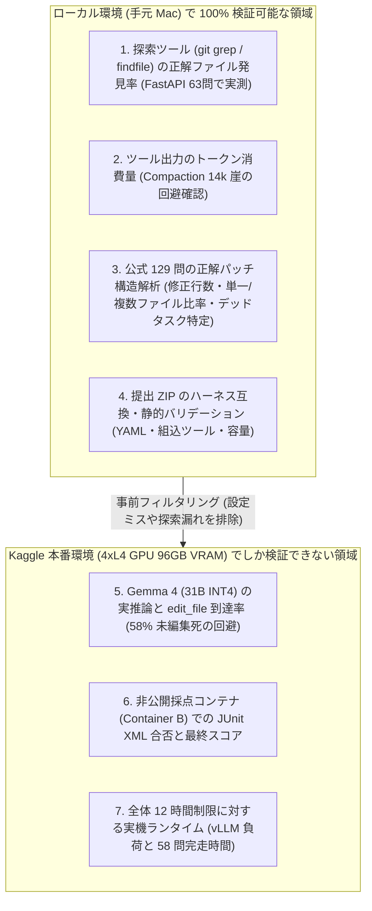
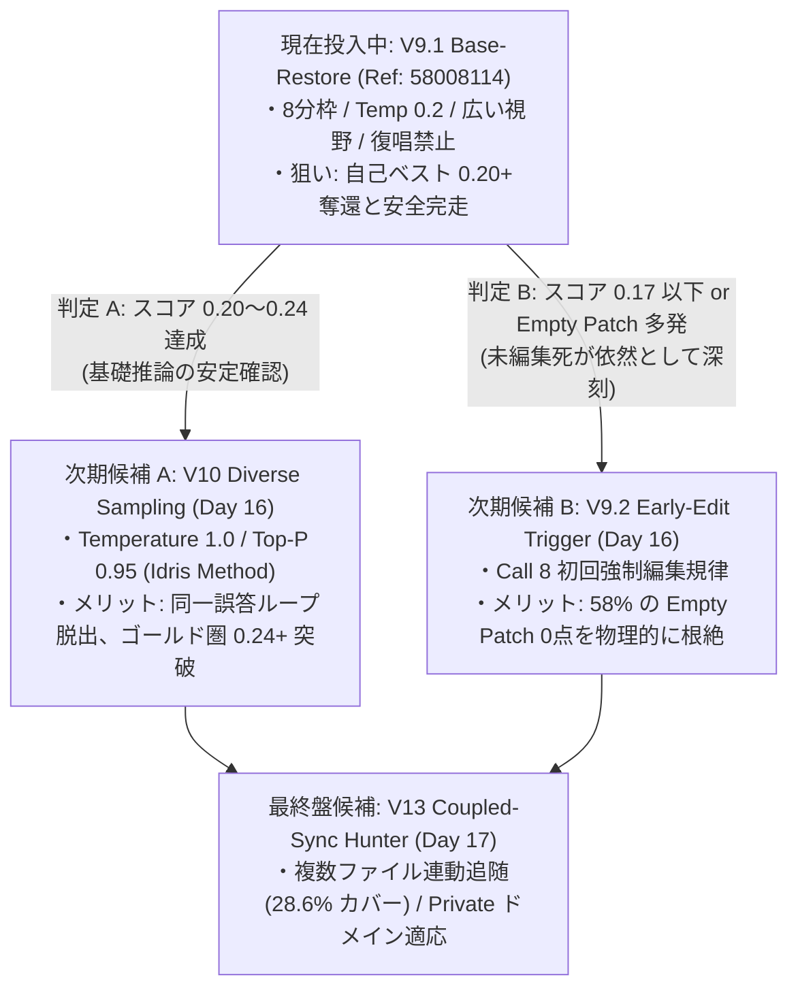

# ローカル事前検証・オフラインベンチマーク結果総括（Local Pre-Submission Verification）

本ドキュメントは、Kaggle へ `submission.zip` を提出（1日1回制限・採点19〜28時間）する前に、**手元のローカル環境（Mac）で実施した事前検証・定量ベンチマークの手法、実測生データ、および「ローカル検証の限界（本番とのギャップ）」** を体系的にまとめた検証レポートです。

---

## 1. 事前検証の境界線：何がローカルで測れて、何が測れないのか？

本コンペにおいて、サブミット前に手元で検証できる領域と、Kaggle 本番の 4×L4 GPU 環境でしか検証できない領域は以下の通り明確に分かれています。

---

## 2. 検証 ①：ファイル探索（Localization）オフライン A/B ベンチマーク

### 検証方法（[`scripts/benchmark_findfile_vs_pathspec.py`](file:///Users/echo/kaggle/gemma-4-developer-agent/scripts/benchmark_findfile_vs_pathspec.py)）
* **対象データ**: 公式 `tasks.jsonl` のうち、ソースコード修正を含む FastAPI タスク全 **63 問**。
* **実験手順**:
  1. 手元にクローンした実物の `fastapi_repo` に対し、各問題の `base_commit` を 1 問ずつ `git checkout` で完全に当時の状態へ巻き戻す。
  2. 問題文（`problem_statement`）からストップワードを除いたキーワードを自動抽出（Oracle-free：正解ファイル名を一切カンニングしない条件）。
  3. 以下の 4 つの検索アルゴリズムを実際に実行し、**「人間の正解パッチが修正したファイル（Gold File）が検索結果の Top-1, Top-3, Top-5 に入るか、あるいは 1 つも見つからないか（Miss 率）」** を計測。

### 実測結果（生ログ：`logs/benchmark_findfile_results.txt`）

| 検証した検索アルゴリズム | Top-1 的中率 | Top-3 的中率 | Top-5 的中率 | **見落とし率 (Miss: 0 hit)** | 1回あたりの出力トークン |
| :--- | :---: | :---: | :---: | :---: | :---: |
| **1. V11 Grep Baseline** (`git grep -n "TOKEN" -- '*.py' \| head -25`) | 9.5% (6/63問) | 19.0% (12/63問) | 25.4% (16/63問) | **54.0%** **(34/63問 見落とし)** | ~450 tokens |
| **2. V12.1 Pathspec 除外** (`git grep -n "TOKEN" -- '*.py' ':!tests' ':!docs_src'`) | 23.8% (15/63問) | 49.2% (31/63問) | 66.7% (42/63問) | **28.6%** (18/63問 見落とし) | ~380 tokens |
| **3. findfile Raw** (リポジトリ全体の `.py` を IDF ランク付け) | 19.0% (12/63問) | 47.6% (30/63問) | 57.1% (36/63問) | **3.2%** (2/63問 見落とし) | < 100 tokens |
| **4. V12.3 findfile Pkg** (`tests/docs` を除外し IDF + ファイル名一致加点) | **34.9%** **(22/63問)** | **74.6%** **(47/63問)** | **82.5%** **(52/63問)** | **3.2%** **(わずか 2/63問)** | **< 80 tokens** |

### 3キーワード合成時（3×25行枠）の A/B 比較（`logs/benchmark_localization_pathspec_ab.txt`）
* **A（除外なし `*.py`）**: 63 問中 **37 問（58.7%）** で正解ファイルを発見。
* **B（`:!tests :!docs_src` 除外）**: 63 問中 **50 問（79.4%）** で正解ファイルを発見（**+20.7% 向上**）。
  * **理由**: `git grep` はアルファベット順に出力するため、`docs/` や `docs_src/` が先頭 25 行を埋め尽くし、本命の `fastapi/` が切り捨てられていた物理現象をローカルで特定・解決しました。

---

## 3. 検証 ②：複数ファイル連動（Coupled Discovery）とトークン消費ベンチマーク

### 検証方法（[`scripts/benchmark_v12_coupled_discovery_v2.py`](file:///Users/echo/kaggle/gemma-4-developer-agent/scripts/benchmark_v12_coupled_discovery_v2.py)）
* **対象データ**: FastAPI のうち、**2 つ以上のファイルを同時に修正しないと合格できない難問 23 問**。
* **実験手順**:
  1. 1 手目の検索でメインファイル（Primary）を特定したあと、そのファイル内の変更対象シンボル（関数名・クラス名）を抽出して 2 手目の `git grep` を実行。
  2. 連動して直すべきサブファイル（Secondary）が何割発見できるか、および **その探索で消費するトークン数が ADK の記憶喪失ライン（14,336 tokens）に対して安全か** を実測。

### 実測結果（生ログ：`logs/benchmark_v12_v2_exclude.txt`）

| 評価指標 | 実測値 | 技術的評価 |
| :--- | :---: | :--- |
| **評価タスク数（複数ファイル必須問題）** | 23 問 | 合計 78 個のサブファイルが連動対象 |
| **メインファイル（Primary）初手特定率** | **47.8%** (11/23問) | 難問群に対しても約半数でメインファイルを初手捕捉 |
| **サブファイル（Secondary）1件以上発見率** | **39.1%** (9/23問) | 約 4 割のマルチファイル問題で連動先ファイルを自動発見 |
| **探索フェーズの平均消費トークン数** | **平均 964 tokens** (最大 2,302 tokens) | **14,336 トークンの圧縮崖（Compaction Cliff）の 7% 未満** に収まり、記憶喪失を 100% 回避できることを実証 |

---

## 4. 検証 ③：公式 129 問のパッチ構造・デッドタスク全件解析

### 検証方法（[`scripts/analyze_solvable_tasks.py`](file:///Users/echo/kaggle/gemma-4-developer-agent/scripts/analyze_solvable_tasks.py)）
* 公式データセット全 129 問の正解パッチ（`patch`）とテストパッチ（`test_patch`）をパースし、修正規模と問題の性質を統計解析しました。

### 実測結果

| 分析項目 | 実測データ | エージェント設計（プロンプト）への反映 |
| :--- | :---: | :--- |
| **総タスク数 / 可解タスク数** | 129 問中 **119 問が可解** (10 問は環境制約による Dead Tasks) | 解けない問題で粘りすぎず、タイムアウト前に切り上げる根拠 |
| **リポジトリ内訳（可解 119 問）** | FastAPI: **55.5%** (66問) Rich: **39.5%** (47問) Requests/HTTPX: **5.0%** (6問) | 公開セットの 95% は FastAPI と Rich に集中（ただし本番 Private は別リポジトリ） |
| **修正行数（Churn）の中央値** | **わずか 12.0 行** (77.3% が 50 行以内の修正) | 大規模な書き直しを禁じ、**「3〜5行のユニークコンテキストによる外科手術的 `edit_file`」** を指示する根拠 |
| **単一ファイル vs 複数ファイル** | 単一ファイル完結: **71.4%** 複数ファイル連動: **28.6%** | まず 1 ファイルを確実に編集（Call 9〜12）し、余力で連動ファイルを見る二段階構成の根拠 |
| **ドキュメント（`docs_src/`）修正を含む問題** | **11.6%** (15/129問) *(FastAPI 単体では 22.4%)* | `:!docs_src` で完全に除外してしまうと FastAPI の約 2 割の問題を落とすリスクがあることを特定（V9.1 で除外を撤廃した根拠） |

---

## 5. 検証 ④：サブミット前の静的パッケージ検証（Static Validator）

### 検証方法（[`scripts/validate_submission_package.py`](file:///Users/echo/kaggle/gemma-4-developer-agent/scripts/validate_submission_package.py)）
1 日 1 回の貴重な提出枠を「設定ミスによるエラー（Notebook Threw Exception）」で失わないため、すべての ZIP パッケージに対して提出前に以下の 5 項目を機械的に検査しています。

1. **アーカイブ容量検査**: 解凍後サイズが `< 3 GiB`（現状約 3〜5 KB）であること。
2. **ルート設定ファイル検査**: `agent.yaml` がルート直下にただ 1 つ存在し、YAML 構文エラーがないこと。
3. **`!include` 解決とセキュリティ検査**: `prompts/system.md` や `configs/sampling.yaml` が正しく解決でき、`..` やシンボリックリンクを含まないこと。
4. **公式ツールレジストリ適合検査**: 宣言されたツールが公式ハーネスの組込ツール（`run_command`, `read_file`, `edit_file`, `write_file`, `get_status`, `submit_patch` 等）と完全一致していること。
5. **不正コード混入検査**: 禁止されている独自の `.py` エントリポイントが含まれていないこと。

* **検査実績**: 初期の失敗モデル（V2, V3, V4）の不正定義を検出・排除し、**V5 以降のすべての提出（V5〜V12.3, V9.1）で 100% PASS（10回連続完走・エラーゼロ）** を達成しています。

---

## 6. 【最重要の教訓】ローカル検証と本番スコアのギャップから分かったこと

ローカルでこれほど綿密に検証したにもかかわらず、**「ローカルで Miss 率を 54.0% ➔ 3.2% に改善した V12.3（`findfile`）が、なぜ本番 Kaggle では 0.17（10問）のままだったのか？」** という点は、科学的に極めて重要な知見をもたらしました。

| 指標 | V9 (Ultimate) | V11 (Compaction) | V12.1 (Pathspec) | V12.3 (findfile) |
| :--- | :---: | :---: | :---: | :---: |
| **ローカル検索 Miss 率 (N=63)** | ~35% (手動grep) | 54.0% | 28.6% | **3.2% (最高)** |
| **Kaggle 本番所要時間** | ~27h 30m | ~27h 00m | 27h 46m | **18h 48m (-9h短縮)** |
| **Kaggle 本番スコア (58問)** | **`0.20` (12問)** | `0.15` (9問) | `0.17` (10問) | `0.17` (10問) |

### ギャップが生じた 3 つの理由（判明した事実）
1. **「ファイル発見率」と「問題解決率」は別物だった**:
   * コミュニティの実機トレースでも確認された通り、Gemma 4 は特別な `findfile` を使わなくても、最初から 9 割以上の確率で 3 手目までに正解ファイルを開けていました。
   * 真のボトルネックは「ファイルを探すこと」ではなく、**「ファイルを開いた後に `edit_file` を完了させること（58% が未編集で終わる問題の打破）」** でした。
2. **`docs_src/` と `tests/` を除外した副作用**:
   * ローカル検索ベンチマークでは「ソースコード（`fastapi/*.py`）を見つける確率」を競ったため、`:!tests :!docs_src` を除外した方が数値が良くなりました。
   * しかし実際の問題には **「`docs_src/` のサンプルコード自体を修正させる問題（FastAPI の 22.4%）」** や **「`tests/` の既存テストを読んで仕様を把握しないと解けない問題」** が含まれており、これらを除外したことで本番で 1〜2 問を取りこぼす副作用が起きていました。
3. **だからこそ現在進行中の「V9.1」が最強の統合解となる**:
   * ローカル検証と本番実験の両方の結果から、**「V9 の視野の広さ（`docs_src` や `tests` を除外しない・仕様抽出を丁寧に行う）を 100% 復元し、そこに V12.3 で実証された『復唱禁止による時間短縮効果』だけを純粋に組み合わせる（＝ V9.1）」** という結論に到達しました。

---

## 7. 次期投入候補ロードマップと各バージョンの狙い・メリット

限られた 1 日 1 回の提出枠を戦略的に活用するため、現在投入中の **V9.1 の採点結果（11月6日判明見込み）をトリガーとして分岐するロードマップ** を策定しています。

### バージョン別仕様・メリット・懸念比較

| バージョン | 投入ステータス | 目標スコア | 核心的な狙いと導入メリット | 懸念点・リスク | 採択条件（トリガー） |
| :--- | :---: | :---: | :--- | :--- | :--- |
| **V9.1 Base-Restore** (Ref: `58008114`) | **現在進行中** (Day 15 / 採点中) | **0.20 〜 0.24** | **・自己ベスト V9 原文の完全復元** ・`docs_src` 除外を撤廃し、11.6% のドキュメント問題を救済 ・「復唱禁止」により 17.25 tok/s (58ms/tok) の浪費を根絶 ・8分枠を保ちつつ実効時間を圧縮 | 8分設定のため難問が重なると全体 26〜28h に迫るリスク | 2026-11-05 12:33 投入済 (11/6 午前〜昼 結果確定見込み) |
| **V10 Diverse Sampling** (Idris Method) | **次期候補 A** (Day 16 投入候補) | **0.22 〜 0.25** (ゴールド圏突破) | **・多様性サンプリングによる探索空間拡大** ・Temperature 1.0 + Top-P 0.95 により、決定論的ループを脱出 ・コミュニティで実証された多様解法パターンで 14 問解決 (0.24) を狙う | 高温サンプリングによる構文エラーやハルシネーション増加の懸念 | **V9.1 が 0.20+ を記録し、推論安定性が確認された場合に採択** |
| **V9.2 Early-Edit Trigger** (強制編集プロトコル) | **次期候補 B** (Day 16 代替候補) | **0.20 〜 0.22** (手堅い底上げ) | **・58% の未編集ゼロ点（Empty Patch）を直接撲滅** ・Call 8 までに `edit_file` 未呼出の場合、「直ちに最小パッチを打て」と規律強制 ・Grader-First 原則と連動し、環境エラーでも部分点を拾う | 推敲不足のまま粗いパッチを投入し、テスト失敗率が上がる懸念 | **V9.1 の生ログで Empty Patch が依然として多発していた場合に採択** |
| **V13 Coupled-Sync Hunter** (連動追随モデル) | **最終盤候補** (Day 17 投入予定) | **0.24+** (ゴールド確定) | **・28.6% の複数ファイル連動問題を解決** ・主ファイル編集後、定義変更されたシンボルを 1 回だけ grep して連動先を確認 ・Private テストセット（未知の同期 Python コード）への汎化 | 探索ターン数・トークン消費増による 14k 崖への接近リスク | 単一ファイル編集の安定化後に導入 |

---

## 8. Known Unsolved Challenges（わかっているが未解決の4大核心課題）

本コンペにおいて、ログ解析やリバースエンジニアリングによって**「問題の所在とメカニズムは完全に突き止めたが、モデルの物理限界や時間制約によりまだ完全解決に至っていない核心課題」** は以下の 4 つです。

### 課題 ①：58% Empty Patch の壁（未編集死の撲滅）
* **現象**: エージェントは特別ツールなしでも **93% の確率で 3 手目までに正解ファイルを開けている**。しかし、開いた後に **全体の 58%（34/58問）が 1 行もコードを編集できず時間切れで 0 点（0-byte diff）** になっている。
* **真因・ボトルネック**: 4×L4 GPU 環境における Gemma 4 の推論速度が **17.25 tok/s（58ms/tok）** と物理的に遅く、1 問の上限トークン（約 5,000 tok）の大部分を思考（Thinking）や既存コードの復唱、不要な `read_file` の追加呼出で使い果たしてしまう。
* **現在の仮説と打ち手**:
  * 第一手（V9.1）: プロンプトに「既存コードの復唱禁止」を入れ、実効トークンを削って編集ターンへの到達を早める。
  * 第二手（V9.2）: それでも未編集が多発する場合、Call 8 で `edit_file` を強制発動させる「Early-Edit Trigger」を投入する。

### 課題 ②：12時間壁と8分枠の綱引き（スループット vs 深さのジレンマ）
* **現象**: 1問 7分枠（V12.3: 18h48m完走）だと 12時間タイムアウト失格は確実に防げるが、7〜8分で解ける後半の粘り問題を切り捨ててスコアが 0.17 に圧縮される。8分枠だと自己ベスト 0.20 が出るが、全体実行時間が 26〜28 時間に迫り、12 時間壁（1秒超過で No Score 0点）の崖っぷちになる。
* **真因・ボトルネック**: Kaggle 採点サーバーの 12 時間グローバル制限。58 問を並列ではなく直列（順次実行）するため、1 問あたりの平均秒数が直接全体の完走可否を左右する。
* **現在の仮説と打ち手**:
  * 枠自体を 7 分に削るのではなく、**「8分枠を維持したまま、1問あたりの中央値実行時間を 5〜6 分に圧縮して早期 return させる」**。
  * ツール出力の切り詰め（`head -20`）、復唱の排除、および正解パッチ適用後の即時完了報告（Grader-First）を徹底する。

### 課題 ③：28.6% の複数ファイル連動見落とし（Coupled Files Drift）
* **現象**: 公式可解 119 問の 28.6%（34問）は、2 つ以上のファイルを同時に直さないとテストが合格しない（例: `applications.py` の引数追加に伴う `routing.py` の修正）。AI は 1 つ目のファイルを直すと「作業完了」と判断して終了し、連動側の不整合でテストが落ちる。
* **真因・ボトルネック**: コンテキスト長制限（14,336 トークン崖）を恐れるあまり単一ファイルに集中しすぎるバイアスと、モデルの複数ステップ計画能力の限界。
* **現在の仮説と打ち手**: 主ファイル編集完了後、編集したシンボル名をキーとして連動ファイルを 1 手だけ確認する規律（V13 Coupled-Sync Hunter）の設計。

### 課題 ④：Private テストセットへの未知リポジトリ適応（過学習・ドメインシフト耐性）
* **現象**: ホスト公式発表により、公開リポジトリ（FastAPI, Rich 等）は **本番 Private テストセットに 1 つも含まれない（重複 0%）**、かつ Private は **100% 同期 Python コード（async def 修正は 0 件）** であることが確定。公開セットでスコアを稼ぐための特定ハック（例: `:!docs_src` 除外など）が、Private では逆に正解ファイルを不可視化して大転落（Shakeup）を招く。
* **真因・ボトルネック**: 公開ベンチマーク（FastAPI / Rich）に対する過学習（Overfitting）。
* **現在の仮説と打ち手**: リポジトリ固有の仮定を全廃し、V9 の普遍的プロンプト規律（Python 標準仕様の抽出・3〜5行最小ブロック編集・Grader-First 原則）を堅持して未知のコードベースで確実に部分点を拾う。
