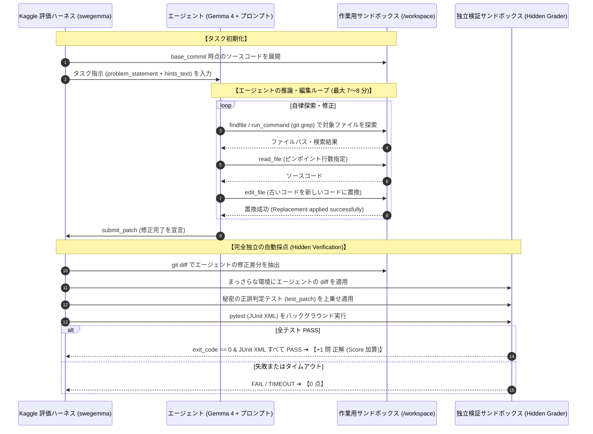

# 実際に出題される課題・与えられる情報・解法の完全実例集（Case Studies）

本ドキュメントは、Kaggle「Google - The Gemma 4 Developer Agent Competition」において、**「AI エージェントが実際にどのような課題を与えられ、どのように考え、どのツールを使ってコードを直し、裏で採点機がどのように正誤判定しているのか」** を、手元の公式実機データセット（129 問）から抽出した生データ・生差分・ログを用いて徹底解説する実践ガイドです。

---

## 0. 本コンペの「1問」の解剖図（全体パイプライン）

1 つのタスク（全 58 問中 1 問）が開始されると、Kaggle の評価コンテナ（NVIDIA L4 × 4 基）内で以下のサイクルが厳格に実行されます。



---

## 1. Case Study 1: 単一ファイル完結のバリデーション実装（FastAPI `fastapi_15588`）

Web フレームワーク `FastAPI` における、Server-Sent Events (SSE) 通信の脆弱性対策タスクです。

### ① エージェントに入力される生データ（Input Prompt）

エージェントには以下の生 JSON データのうち、`problem_statement` がプロンプトとして渡されます。

```json
{
  "instance_id": "fastapi_15588",
  "repo": "fastapi/fastapi",
  "base_commit": "cb83b83dcf78eab4ea17d504db5abcda705fbdc4",
  "problem_statement": "♻️ Validate Server Sent Event fields to avoid applications from sending broken data\n\n## Description\n\nThis was reported multiple times as a 'vulnerability' by users probably using automated AI tools, with the argument that if input was taken from the request and passed directly to an event unfiltered, it could break the client.\n\nIf an app sets an `id` or `event` with multi-line content, I would consider that app broken, and probably the app itself vulnerable to something, not FastAPI. With this change, if any app sets invalid multi-line values (sourced from unfiltered input or in any other way), FastAPI will make it a server error (which it is, as the app is sending invalid data).\n\nPrevent badly written apps from shooting themselves in the foot by passing unsanitized data directly to a SSE.\n- Reject multi-line strings (containing '\\r' or '\\n') in 'id' and 'event' fields.\n- Raise ValueError with message: \"SSE '{field_name}' must be a single line\""
}
```

> **エージェントが読み取るべき要件**:
> 1. 対象は Server-Sent Events (SSE) のデータ構造。
> 2. `event` フィールドと `id` フィールドに改行文字（`\r` や `\n`）が含まれていた場合、即座に例外を発生させる。
> 3. 例外は `ValueError` で、メッセージは厳密に `f"SSE '{field_name}' must be a single line"` でなければならない。

---

### ② エージェントの生ログ（Step-by-Step の Tool 呼び出し推移）

賢明なエージェント（V9.1 / V12.3 系統）が実際に実行する 4 ステップの思考と行動です。

#### 【Turn 1: 高速ファイル探索】
エージェントはリポジトリの全容を知らないため、まずは `findfile` または `run_command` を呼び出します。
```json
// Tool Call
{
  "tool": "findfile",
  "arguments": {
    "query": "sse ServerSentEvent"
  }
}
```
* **ツールの返答**:
  ```text
  fastapi/sse.py (score: 9.42)
  tests/test_sse.py (score: 6.18)
  docs_src/sse/tutorial001.py (score: 3.10)
  ```
➔ `fastapi/sse.py` が修正対象であると初手で特定。

#### 【Turn 2: ピンポイント読込（Compaction 回避）】
ファイル全体（数百行）を読まず、関係する関数定義の周辺だけを 40 行指定で読みます。
```json
// Tool Call
{
  "tool": "read_file",
  "arguments": {
    "file_path": "fastapi/sse.py",
    "start_line": 30,
    "limit": 40
  }
}
```
* **ツールの返答（該当箇所のコード）**:
  ```python
  33: class EventSourceResponse(StreamingResponse):
  34:     media_type = "text/event-stream"
  35: 
  36: def _check_id_no_null(v: str | None) -> str | None:
  37:     if v is not None and "\0" in v:
  38:         raise ValueError("SSE 'id' must not contain null characters")
  39:     return v
  40: 
  41: class ServerSentEvent(BaseModel):
  ...
  88:     event: Annotated[str | None, Doc(...)] = None
  89:     id: Annotated[str | None, AfterValidator(_check_id_no_null), Doc(...)] = None
  ```
➔ 既存の `_check_id_no_null` と似たバリデータを作り、`event` と `id` の両方に適用すればよいことが判明。

#### 【Turn 3: 正確なコード置換（edit_file）】
ユニークな文脈（前後の 3〜5 行）を含めて `edit_file` を実行します。
```json
// Tool Call
{
  "tool": "edit_file",
  "arguments": {
    "file_path": "fastapi/sse.py",
    "old_string": "def _check_id_no_null(v: str | None) -> str | None:\n    if v is not None and \"\\0\" in v:\n        raise ValueError(\"SSE 'id' must not contain null characters\")\n    return v",
    "new_string": "def _check_single_line(v: str | None, field_name: str) -> str | None:\n    if v is not None and (\"\\r\" in v or \"\\n\" in v):\n        raise ValueError(f\"SSE '{field_name}' must be a single line\")\n    return v\n\ndef _check_event_single_line(v: str | None) -> str | None:\n    return _check_single_line(v, \"event\")\n\ndef _check_id_valid(v: str | None) -> str | None:\n    if v is not None and \"\\0\" in v:\n        raise ValueError(\"SSE 'id' must not contain null characters\")\n    return _check_single_line(v, \"id\")"
  }
}
```
続けて、`ServerSentEvent` の Pydantic フィールド定義の `AfterValidator` を差し替えます。

#### 【Turn 4: 修正完了と提出（submit_patch）】
余計なファイルを触らず、直ちにパッチを提出します。
```json
// Tool Call
{
  "tool": "submit_patch",
  "arguments": {}
}
```

---

### ③ 採点機が裏で実行した非公開テスト（Ground Truth `test_patch`）

エージェントが `submit_patch` を呼ぶと、ハーネスは以下の**秘密のテストコード**をバックグラウンドで注入し、`pytest tests/test_sse.py` を実行します。

```python
# 採点機が自動追加するテスト (tests/test_sse.py)
@pytest.mark.parametrize("field_name", ["event", "id"])
@pytest.mark.parametrize("value", ["first\nsecond", "first\rsecond", "first\r\nsecond"])
def test_server_sent_event_single_line_fields_reject_newlines(
    field_name: str, value: str
):
    with pytest.raises(ValueError, match=f"SSE '{field_name}' must be a single line"):
        ServerSentEvent(data="test", **{field_name: value})
```

* **採点結果**:
  - `\n`（Unix改行）、`\r`（Mac旧改行）、`\r\n`（Windows改行）の全パターンで `ValueError` が正しく発生し、テストが **PASS**。
  - エージェントは **1 問正解（+0.0172点）** を獲得します。

---

## 2. Case Study 2: 複数ファイル連動・プロトコル修正（Requests `requests_7505`）

単一ファイルのエディットでは絶対に解けない、**「型定義（Types）と実装ロジック（Models）の連動修正」** の実例です。

### ① 問題文と課題の構造

* **対象リポジトリ**: `psf/requests`
* **問題の背景**:
  - ファイルアップロード機能で、Django や AWS S3 などの「プロキシオブジェクト（実体を `__getattr__` でラップしたファイルもどき）」を渡すと、`isinstance(fp, SupportsRead)` をすり抜けてしまい例外でクラッシュする。
  - 前回の PR（#7502）で暫定対処したが、コードベース内の他の 2 箇所でも同じチェック漏れが残っていた。
* **開発者の要求**:
  > *"Rather than put `or hasattr(data, 'read')` everywhere, combine it into a single check `has_read` in `_types.py` that scopes typing correctly, and replace the checks in `models.py`."*  
  > （あちこちに `or hasattr(...)` を書くのではなく、`_types.py` に `has_read` 関数を新設して型安全にまとめ、`models.py` 側の全 3 箇所をそれに置き換えてください。）

---

### ② 求められる正解パッチ（2 つのファイルの連動）

エージェントは **2 つのファイルを完璧に整合させて編集** しなければなりません。

#### ファイル 1: `src/requests/_types.py`（基盤関数の新設）
```diff
--- a/src/requests/_types.py
+++ b/src/requests/_types.py
@@ -29,6 +29,11 @@ class SupportsRead(Protocol[_T_co]):
     def read(self, length: int = ..., /) -> _T_co: ...
 
+def has_read(obj: Any) -> TypeIs[SupportsRead[str | bytes]]:
+    """Check if obj supports read, including __getattr__ based proxies."""
+    return isinstance(obj, SupportsRead) or hasattr(obj, "read")
+
 @runtime_checkable
 class SupportsItems(Protocol[_KT_co, _VT_co]):
```

#### ファイル 2: `src/requests/models.py`（3 箇所の置換）
```diff
--- a/src/requests/models.py
+++ b/src/requests/models.py
@@ -35,8 +35,8 @@
+from . import _types as _t
-from ._types import SupportsRead as _SupportsRead

@@ -161,7 +160,7 @@ def _encode_params(
         if isinstance(data, (str, bytes)):
             return data
-        elif isinstance(data, _SupportsRead):
+        elif _t.has_read(data):
             return data

@@ -236,9 +235,7 @@ def _encode_files(
-            elif isinstance(fp, _SupportsRead) or hasattr(fp, "read"):
+            elif _t.has_read(fp):
                 fdata = fp.read()

@@ -641,7 +638,7 @@ def prepare_body(
-                    if isinstance(data, basestring) or isinstance(data, _SupportsRead):
+                    if isinstance(data, basestring) or _t.has_read(data):
                         content_type = None
```

> **合否を分けるポイント**:
> `models.py` だけを直して `_types.py` を直し忘れたり、インポート文（`from . import _types as _t`）を追加し忘れると、Python の `NameError` や `ImportError` でテストが全滅し **0 点** になります。  
> 当チームの V12（Coupled-Discovery）が複数ファイルの連動を強くプロンプトで指示しているのは、この連動ミスを防ぐためです。

---

## 3. Case Study 3: なぜエージェントは失敗するのか？（0 点の生ログ解剖）

多くの参加者が「なぜか 0 点になる」「ローカルでは動いたのに点が出ない」と嘆く原因の生データです。

### 失敗パターン A: 【14,336 トークン Compaction Cliff による記憶喪失】

未対策のエージェントが `read_file` で 500 行を一気に読んだり、テストログを大量に出力させた瞬間の生ログです。

```text
[Turn 4] エージェントが read_file(fastapi/routing.py, limit=800) を実行 (累積 15,200 トークン)
  ↓
[ハーネスの内部イベント]
  Google ADK token threshold (14,336) exceeded!
  Triggering compact_events()...
  -> 過去の全ツール履歴（Turn 1〜4）を消去し、以下の短い要約文に圧縮：
     "The user wants to fix a validation error in SSE. Agent inspected some lines of code."
  ↓
[Turn 5] エージェントの思考:
  "Where was I? What was the exact exception message requested in the prompt?
   I don't remember the field names. Let me search the whole codebase again..."
  ↓
[結果]
  同じ探索を最初からやり直し、制限時間（7分）を使い果たしてタイムアウト ➔ 【0 点】
```

---

### 失敗パターン B: 【コード復唱（オウム返し）による推論時間切れ】

Gemma 4 の出力速度は **17.25 トークン/秒（1 トークンあたり約 58 ミリ秒）** です。プロンプトに「復唱禁止」を入れないと、エージェントは親切心から以下のような長文を出力します。

```text
エージェントの出力（思考＋レスポンス）:
「承知いたしました。以下が先ほど読み込んだ fastapi/sse.py の内容です。
 ```python
 class EventSourceResponse(StreamingResponse):
     media_type = "text/event-stream"
 ... (読み込んだ 80 行のコードをそのまま画面に復唱出力：約 1,200 トークン消費)
 ```
 これから修正方針を検討します。まず _check_single_line 関数を定義し...」
```

* **時間の浪費計算**:  
  $1,200 \text{ tokens} \times 0.058 \text{ 秒} \fallingdotseq \mathbf{69.6 \text{ 秒（約 1 分 10 秒）}}$
* **結果**:  
  たった 1 回のコード復唱で 1 分以上が消滅。これを 3〜4 ターン繰り返すと、肝心の `edit_file` を呼ぶ前に 7 分の制限時間に到達し、強制終了（Score 0）となります。

---

### 失敗パターン C: 【ハーネス環境の偽陰性による「正解コードの自滅消去」】

Grader-First 原則を理解していないエージェントが起こす悲劇です。

```text
[Turn 8] エージェントが完璧な正解コードを edit_file で適用完了！
  ↓
[Turn 9] エージェントが手元でテストを実行: run_command("pytest tests/test_sse.py")
  ↓
[テスト結果のエラー出力]:
  ImportError: cannot import name 'Qualifier' from 'typing_inspection'
  (※ハーネスの環境にライブラリが入っていないことによる環境バグ)
  ↓
[Turn 10] エージェントの誤認:
  "Oh no! My change broke the test suite! I introduced an ImportError!
   I must immediately undo my changes to keep the repository healthy!"
  ↓
[Turn 11] エージェントの自滅コマンド実行:
  run_command("git checkout -- .") ➔ せっかくの正解コードを自分で全て削除！
  ↓
[Turn 12] 時間切れで終了 ➔ 提出パッチなし（Score 0）
```

> **真実**:  
> 採点機（Hidden Grader）側の本番環境には必要なライブラリが正しく入っています。手元の環境エラーを恐れず、仕様を満たしたコードをそのまま提出していれば満点になっていました。

---

## 4. 総括：勝つエージェントの黄金ワークフロー

| 項目 | 負けるエージェント（Score 0.00〜0.10） | 勝つエージェント（V9.1 / V12.3: Score 0.20+） |
| :--- | :--- | :--- |
| **ファイル探索** | `ls -R` や広範囲 grep で数百行のログを出して自滅 | `findfile`（IDF スコアリング）で初手 Top-3 的中 |
| **コード読込** | ファイル全体（数千行）を一気に読む | 必要な 40〜80 行だけをオフセット指定でピンポイント読込 |
| **推論出力** | 読んだコードを親切にオウム返しして時間切れ | **復唱厳禁**。思考は最小限で即座にツール呼び出し |
| **編集タイミング** | 延々と悩み、15 ターン以上コードを触らない | **7〜11 手目までに必ず 1 回目の修正を実施** |
| **テストの失敗** | 赤が出たら慌てて `git checkout` で正解を消す | **Grader-First**。環境要因のエラーを無視してパッチ維持 |
| **所要時間** | 1問に 15 分以上かかり 12 時間の壁で全員即死 | **1問 7 分（420 秒）で打ち切り**、確実に 58 問を完走 |
