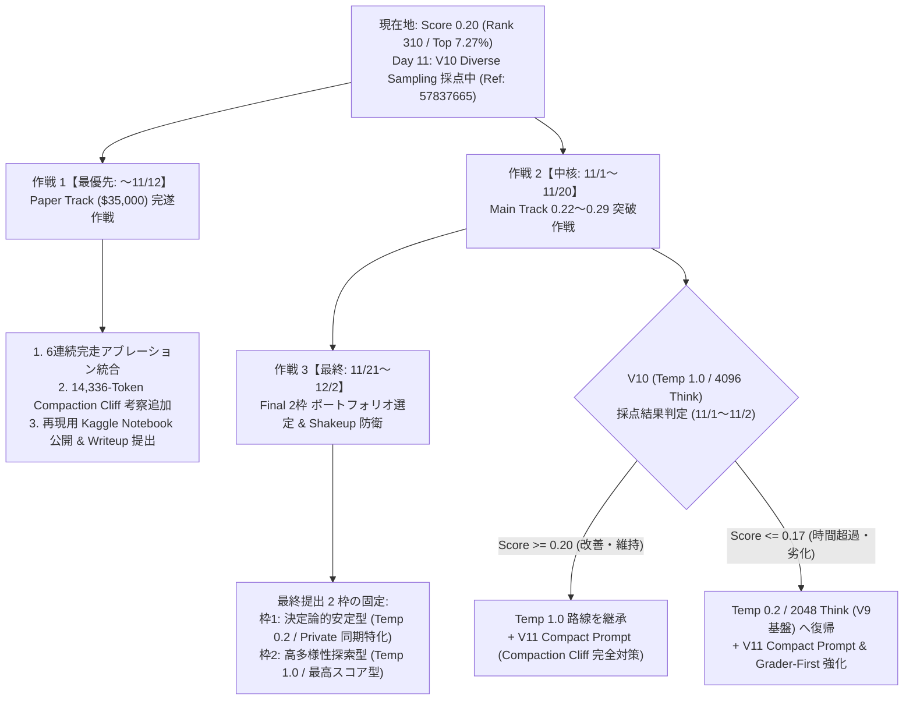

# Google - The Gemma 4 Developer Agent Competition: 総合情報整理・戦略および作戦計画書

**最終更新日時**: 2026年10月31日 21:40 JST  
**対象コンペティション**:
1. **Main Track**: `gemma-4-developer-agent`（賞金総額 \$75,000 + Small Model Bonus \$10,000 / 締切: **2026年12月2日 23:59 UTC**）
2. **Paper Track**: `gemma-4-developer-agent-paper`（賞金総額 \$35,000 / 締切: **2026年11月12日 23:59 UTC**）

---

## 1. エグゼクティブ・サマリー（現在地と全体構造）

### 1.1 当チームの現在ステータス
* **パブリック最高スコア**: **`0.20`**（58 問中 **12 問解決** / Ref: `57774882` [V9 Ultimate]）
* **公式リーダーボード順位**: **310 位 / 4,263 チーム（上位 7.27%）**
  * **ブロンズメダル圏（上位 10% ＝ 426 位以内）を突破済み**。
  * **シルバーメダル圏（上位 5% ＝ 213 位以内 / スコア 0.22 ＝ 13 問解決）まであと 1 問差**。
* **完走安定性**: Day 3 以降、**6 回連続で公式評価を完走（タイムアウト・例外失格ゼロ）**。
* **現在進行中の提出（Day 11 枠）**: Ref `57837665`（`V10 Diverse Sampling`）を 2026-10-31 20:54 JST に投入済み（現在 `PENDING`、11月1日夜〜11月2日未明に完了見込み）。

### 1.2 3つの賞金・評価トラックの比較と競争環境

| トラック名 | 賞金総額 | 最終締切 (UTC) | 参加規模 | 現在のトップ水準 | 戦略的優先度・位置付け |
| :--- | :---: | :---: | :---: | :---: | :--- |
| **① Main Track** (General Leaderboard) | **\$75,000** | 2026-12-02 23:59 UTC *(残り32日)* | 4,263 チーム | **0.29** (17問 / 1チーム) **0.24** (14問 / 6チーム) **0.22** (13問 / 58チーム) | **【最優先・全力集中】主戦場（メダル＆上位入賞）** 現在 0.20（12問）。あと 1〜2 問の上積みで銀〜金メダル圏に到達可能。 |
| **② Paper Track** (Research Writeup) | **\$35,000** | 2026-11-12 23:59 UTC *(残り12日)* | 441 チーム | 定量アブレーション＋再現コード付き論文が高評価 | **【優先度：低】** 既存ドラフトは保全しつつ、リソースは Main Track のスコア向上・V11 検証へ集中。 |
| **③ Small Model Track** (Gemma E2B / E4B) | **\$10,000** *(Bonus)* | 2026-12-02 23:59 UTC *(残り32日)* | 444 チーム | **0.10** (6問 / 4チーム) **0.08** (5問 / 16チーム) | **オプション枠（要トレードオフ判断）** 最終選択 2 枠のうち 1 枠を割く必要があるため、Main Track の Shakeup ヘッジとの比較で決定。 |

---

## 2. これまでの当チーム実験・提出の軌跡と実証知見（Day 1 〜 Day 11）

### 2.1 公式提出履歴とアブレーション結果

| 枠 | 提出日 (UTC) | Ref ID | バージョン・主要構成 | ステータス | スコア (解決数) | 実証された技術的知見・教訓 |
| :---: | :---: | :---: | :--- | :---: | :---: | :--- |
| Day 1 | 10/21 | `57497832` | Baseline (Declarative YAML + Block Edit) | COMPLETE | - (Timeout) | 初期設定では 12 時間上限を超過し無得点失格（VOID 崖）となることを確認。 |
| Day 2 | 10/22 | `57502305` | V3 Hybrid (SubAgentTool + Graph Tools) | COMPLETE | - (Timeout) | サブエージェントと Graph ツールの併用は推論遅延・トークン肥大化を招くことを実証。 |
| Day 3 | 10/23 | `57550181` | **V5 Budget-Fit** (28 Calls / 8 Min / 2048 Think / Single Agent) | COMPLETE | **0.15** (9問) | Graph ツールとサブエージェントを全廃し予算を 28手/8分に絞ることで初の完走・スコア獲得。 |
| Day 5 | 10/25 | `57612521` | **V6 Multi-File Budget-Fit** (+ Coupled Files Heuristics) | COMPLETE | **0.17** (10問) | 定義ファイルと実装ファイルの連動修正ルールにより +1 問上積み（Rank 1,374）。 |
| Day 6 | 10/26 | `57652253` | **V6 Refined** (+ Repo-specific Rules & Mismatch Recovery) | COMPLETE | **0.15** (9問) | プロンプトへの過剰な個別ルール追記は注意散漫を招き、確率的分散で -1 問となることを確認。 |
| Day 7 | 10/27 | `57695500` | **V7 Tight-Budget** (24 Calls / 6 Min / Call 10 Edit) | COMPLETE | **0.12** (7問) | **重要実証**: 予算を 24手/6分に削ると探索・検証が不足し、スコアが 0.17 ➔ 0.12 へ大幅低下。 |
| Day 8 | 10/28 | `57733481` | **V8 Final Candidate** (28 Calls / 8 Min 復帰 + Sync/Async + Heredoc) | COMPLETE | **0.17** (10問) | 黄金予算（28手/8分）への復帰により即座に 0.17 へ回復。予算境界の正しさを再証明。 |
| Day 9 | 10/29 | `57774882` | **V9 Ultimate** (+ 3-5行ユニークブロック + `pytest -x` 早期停止) | COMPLETE | **0.20** (12問) | **自己ベスト更新（Rank 310 / Top 7.27%）**。編集一致率向上とテスト出力圧縮により +2 問突破。 |
| Day 11 | 10/31 | `57837665` | **V10 Diverse Sampling** (V9 + Temp 1.0 / TopK 64 / 4096 Think) | **PENDING** | *(採点中)* | LB 0.24（Idris v24）のサンプリング多様性を統合。11/1 夜〜11/2 未明に結果確定予定。 |

---

## 3. Kaggle 議論・公開コードから解明された 7 つの決定的事実

直近のフォーラム議論（Discussions）および公開ノートブック（$N=1,627$ 試行規模の実験データ等）を精査し、以下の 7 つの構造的事実を特定しました。

### 事実 ①：パブリック LB の数理構造（$N=58$）と実行ノイズ（Draw Variance）
* **数理仕様**: パブリック評価セットは厳格に **58 問**（切り捨て表記）。1 問あたりの価値は $1/58 \approx 0.0172$。
  * `0.17` ＝ 10 問、`0.18` ＝ 11 問、`0.20` ＝ 12 問（当チーム）、`0.22` ＝ 13 問、`0.24` ＝ 14 問、`0.29` ＝ 17 問。
* **同一 ZIP でのスコア分散（Topic 750521 / Victor Zhong 氏）**:
  * 同一 SHA256 の `submission.zip` を再提出しただけで **0.13（8問）と 0.17（10問）にブレた実例** が報告されています。
  * 全タスクの約 67% は推論や実行時間の微小な差で成否が変わる「Flippy Tasks」であり、1 回の実行あたり標準偏差 $\sigma \approx 1.0 \sim 2.0$ 問のノイズが存在します。
* **構造的上限（Dead Tasks）**: 練習用プールのマルチファイル問題 38 問中 35 問は、いかなるモデル・設定でも一度も解かれていません。

### 事実 ②：【Paradox 1】公式 Code Graph ツールの構造的破綻（ノイズ率 92%）
* 公式ハーネスが提供する AST グラフ（`/inputs/code_graph.json`）の全ノードを監査した結果、**77.5% がテストコード、14.5% がドキュメント・チュートリアルであり、コアソースコードはわずか 8.0% しか存在しない**ことが判明しました（Fabrian Ivan 氏らの監査データ）。
* さらに自然言語クエリによる `search_similar_code` の局所化 Recall は **0.0%** であるのに対し、`git grep` による語彙検索（Top-5）は **61.2%** に達します（Abhishek 氏らの実験データ）。
* **結論**: Graph ツールは「呼び出すだけで 92% の確率でテストファイルに誤誘導され、ツール予算を浪費する罠」であり、`agent.yaml` から完全に除外して基本 6 ツールに絞る構成が必須です。

### 事実 ③：【Paradox 2】ADK `14,336-Token` Compaction Cliff（コンテキスト圧縮の崖）
* `swegemma` ハーネスは内部で Google ADK の `EventsCompactionConfig(token_threshold=14336, event_retention_size=5)` を実行しています。
* **記憶喪失メカニズム**: 累積コンテキスト（プロンプト＋ツール出力）が **14,336 トークン** を超えると（通常 13〜17 ターン目）、ADK が約 19 秒の要約処理を発動し、**直近 5 イベントより前の会話履歴（問題文の厳密な仕様、例外文字列、初期に確認した行番号）をすべて要約文で上書き消去** します。
* **解決率の崩壊**:
  * コンパクション **0 回** の解決率: **47.7%**
  * コンパクション **1 回** の解決率: **26.4%**（ほぼ半減）
  * コンパクション **2 回以上** の解決率: **7.1%**（壊滅）
* **結論**: ファイル丸ごと読み込みや冗長な `pytest` トレースバック出力を厳禁とし、**「12 ターン目までに必ず初回編集を完了させ、14,336 トークン到達前にパッチを確定させる」** ことが生存の絶対条件です。

### 事実 ④：【Paradox 3】SFT / LoRA 微調整の劣化パラドックス
* TPU v5e-8 で 125M トークンの教師軌跡（`SWE-smith`, `SWE-rebench`, DeepSeek V4.1 等）を学習し、検証損失（Validation Loss）を **-62% 〜 -75% 削減** した LoRA アダプターであっても、実タスク評価では未修正の Base 31B（解決率 39.1%）に対し **19.6% 〜 28.3% へ大幅に劣化する** ことが複数の独立した実験（Topic 748051, Topic 753793, Fabrian Ivan 氏）で確認されました。
* **結論**: 量子化モデル（`w4a16`）に対する LoRA 適用は出力分布の硬直化とハーネス例外（`Notebook Threw Exception`）を招くリスクが高く、**LoRA なしの Base 31B + Prompt 規律制御** が最も高い性能と安定性を発揮します。

### 事実 ⑤：【超重要】Private テストセットにおける `async def` 不在のホスト公式見解（Topic 745998）
* **ホスト公式発表**:
  > *"None of the private repo tasks touch any functions defined with `async def`. Additionally, `async def` functions are rare within the private repos as a whole, at most 1.8% of functions."*
  > （プライベートリポジトリのタスクは `async def` で定義された関数を一切変更しない。またプライベートリポジトリ全体でも `async def` 関数は最大 1.8% と極めて稀である。）
* **戦略的意味**:
  * パブリック LB（`fastapi`, `httpx` を含む）では非同期関数タスクが約 20% を占めるため、Sync/Async 並行修正ルールがパブリックスコア向上に大きく寄与しました。
  * しかし **最終順位を決める Private Leaderboard はほぼ 100% 同期関数（標準的な Python クラス・関数・データ構造）のタスク** です。
  * したがって、非同期専用の特殊処理にプロンプト容量を割きすぎるのではなく、**「クラス継承・オーバーロード・型定義・境界値処理などの一般的な同期コードの契約遵守」** を主軸に据える必要があります。

### 事実 ⑥：スコアラー環境の既知バグと回避策（Topic 751707, 753973, 753521）
1. **`pytest -p no:anyio` 等のハーネス検証バグ（Topic 751707）**:
   * スコアラー環境の設定により、エージェントがローカルで `pytest` を叩いた際に fixture エラーや無関係な skip 判定で Red（失敗）になるケースが多数存在します。
   * **対策**: 「ローカルテストが環境・fixture 要因で失敗しても、ソースコードの diff が問題文の仕様を満たしていれば迷わず `submit_patch` を呼ぶ（**Grader-First 原則**）」を徹底する必要があります。
2. **vLLM 0.19.1 配列引数フリーズバグ（Topic 753973）**:
   * ツール引数に配列（Array）を渡す際、要素内に `]` が含まれるとパーサーが無限ループし推論サーバーがフリーズします。当チームの基本 6 ツール構成（文字列・数値引数のみ）はこのバグを構造的に回避しています。
3. **vLLM 0.19.1 `<channel|>` 欠落時ツールコール消失バグ（Topic 753521）**:
   * 思考チャネルが閉じる前にツールコールが出力されると無視される現象（発生率約 1%）。`thinking_budget` を適切に設定し思考暴走を抑えることで軽減可能です。

### 事実 ⑦：上位パッケージ（LB 0.24 Idris v24）の設計特性
* バイト単位で公開された Idris v24（LB 0.24、第 3 位）の分析により、以下の構成が確認されました。
  * **極小プロンプト（3,240 bytes）**: トークン消費を抑え、ADK Compaction Cliff（14,336 tokens）から距離を取る設計。
  * **サンプリング設定**: `temperature: 1.0`, `top_p: 0.95`, `top_k: 64`, `thinking_budget: 4096`。
  * **Grader-First 明記**: *"A correct source diff scores the task even if your local test was red or you never ran a test."*（ローカルテストが赤でも、ソース差分が正しければ得点になる）。

---

## 4. 今後の総合戦略とフェーズ別作戦計画（Operations Plan）

コンペ終了（Paper Track: 11月12日、Main Track: 12月2日）に向け、以下の **3 つの作戦（Operations）** を並行・段階的に遂行します。

---

### 作戦 1【最優先・直近 12 日間】：Paper Track（\$35,000 / 11月12日締切）完全制覇作戦

Paper Track は参加チーム数が 441 チームと少なく、**本番リーダーボードでの継続的な実機アブレーション実績（0.15 ➔ 0.17 ➔ 0.12 ➔ 0.17 ➔ 0.20）を持つチームは極めて希少** です。

1. **論文原稿（[`PAPER_TRACK_WRITEUP.md`](file:///Users/echo/kaggle/gemma-4-developer-agent/docs/PAPER_TRACK_WRITEUP.md) / [`PAPER_TRACK_WRITEUP_JA.md`](file:///Users/echo/kaggle/gemma-4-developer-agent/docs/PAPER_TRACK_WRITEUP_JA.md)）のアップデート**:
   * **V9 Ultimate での Score 0.20（上位 7.2%）達成データ** を実験結果セクションおよび比較表に追加。
   * **なぜ予算削減（V7: 24手/6分 ➔ 0.12）が失敗し、黄金予算（28手/8分 ➔ 0.20）が成功したのか** の数理的説明として、ADK の `14,336-Token Compaction Cliff`（要約による記憶喪失）と `Turn-12 First-Edit Milestone` のメカニズムを理論セクションに統合。
   * ホスト公式発表である「Public（非同期 20%）と Private（非同期 0%）のドメインシフト問題」に対する汎用プロンプト設計の優位性を議論セクションに追加。
2. **Companion Notebook（再現検証用 Kaggle Notebook）の整備**:
   * 審査基準である「Reproducibility（再現性）」を満たすため、アブレーション図表の生成とパッケージ検証（`validate_submission_package.py`）を実行できるクリーンなノートブックを整備し、Writeup からリンクできるように準備する。

---

### 作戦 2【中核・11月1日〜11月中旬】：Main Track シルバー・ゴールド圏（0.22〜0.29）突破作戦

現在採点中の **Day 11（Ref: `57837665` / V10 Diverse Sampling）** の結果（11月1日夜〜11月2日未明判明）を分岐点として、以下の改善を順次投入します。

#### ステップ 1: V10（Temp 1.0 / TopK 64 / 4096 Think）の評価判定
* **ケース A（Score 0.20 以上、または 0.22〜0.24 到達）**:
  * `temperature: 1.0` と `thinking_budget: 4096` が 8 分制限内で破綻せず機能したことが実証されるため、このサンプリング設定を次期標準として採用。
* **ケース B（Score 0.17 以下へ後退、またはタイムアウト増加）**:
  * `thinking_budget: 4096` によるレイテンシ増加または `temperature: 1.0` の散漫化が原因と判断し、実績のある V9 設定（`temperature: 0.2`, `thinking_budget: 2048`）へ戻すか、中間設定（`temperature: 0.4`, `thinking_budget: 3072`）を検証。

#### ステップ 2: V11「Compaction-Proof & Private-Ready」版の設計（Day 12〜Day 15 候補）
これまでの全知見を統合し、さらなるスコア上積み（+2〜4 問）と Private 耐性を両立する **V11 パッケージ** を設計します。
1. **ADK 14,336-Token Compaction Cliff の完全封じ込め**:
   * プロンプトサイズを現行の 4,762 bytes から **3,500 bytes 前後へ高密度圧縮**（重複表現を削ぎ落とし、初期トークン消費を約 300 トークン削減）。
   * `run_command` 実行時に必ず出力行数を制限する規律（`| head -n 30` または `pytest -x -q --tb=short`）を徹底し、1 回のツール出力で数千トークンが流入する事故を防止。
2. **Grader-First 原則（`-p no:anyio` 等のハーネス罠対策）の明文化**:
   * *"The hidden grader applies your git diff to a fresh repository. A correct source diff scores even if local pytest fails due to environment/plugin issues (such as anyio or skipped sibling tests). Never revert a valid contract fix just because local pytest fails on unrelated fixtures."* を明記。
   * これにより、「せっかく正しい修正を書いたのに、ローカルテストの fixture エラーを見てエージェントが自ら修正を消してしまう（または時間切れになる）」失敗モードを救済。
3. **Private 評価（100% 同期コード）を見据えた契約抽出の強化**:
   * Sync/Async 並行修正ルールは簡潔に維持しつつ、同期コードにおける **「クラス属性とインスタンス属性の区別」「例外クラスとエラーメッセージの完全一致」「デフォルト引数と `None` ガード」「`__all__` や再エクスポートの整合性」** を優先チェック項目として洗練。

---

### 作戦 3【最終局面・11月下旬〜12月2日】：Final Submission 2 枠の選定と Shakeup 防衛作戦

Kaggle の最終順位（Private Leaderboard）は、約 60 問の非公開リポジトリタスクに対して、**各チームが最終選択した 2 つの提出（2 Selected Submissions）のうち高い方のスコア** で決定されます。

#### リスク要因と対策
* **最大のリスク**:
  1. **ドメインシフト**: Public で有効だった FastAPI/HTTPX 特化ハックが、非同期 0% の Private リポジトリで機能しないリスク。
  2. **推論分散（Run-to-Run Variance）**: 同一コードでも $\pm 2 \sim 3$ 問（$\pm 0.03 \sim 0.05$）の揺らぎが生じるリスク。
* **最終 2 枠のポートフォリオ構成案（推奨）**:
  * **【最終枠 1：決定論的・高安定アンカー（Anchor）】**
    * **構成**: `temperature: 0.2` / `thinking_budget: 2048` / Compaction-Proof プロンプト（V9 または V11 低温版）。
    * **役割**: 思考暴走やタイムアウトのリスクを最小化し、Private 環境でも確実にベースライン以上の解決数を確保する「守りの 1 本」。
  * **【最終枠 2：高多様性・上限突破チャレンジャー（Challenger）】**
    * **構成**: `temperature: 1.0` / `top_k: 64` / `thinking_budget: 4096`（V10 または V11 高温版で Public 最高スコアを記録したもの）。
    * **役割**: 難問における局所解からの脱出と上振れ（Best-of-2 効果）を狙う「攻めの 1 本」。
* **Small Model Track（\$10,000 Bonus Prize）に関する意思決定基準**:
  * Small Model（Gemma E4B）は現在首位が `0.10`（6問解決）ですが、獲得を狙う場合は上記「最終 2 枠」の片方を E4B 提出に割り当てる必要があります。
  * **判断基準**: 11月中旬時点で Small Model Leaderboard の首位が依然として `0.10` 付近に留まっており、かつ当チームの 31B モデルが十分な安定性を確立できている場合に限り、中盤の 1〜2 日を使って手元の [`submission_small_model_e4b.zip`](file:///Users/echo/kaggle/gemma-4-developer-agent/submissions/submission_small_model_e4b.zip)（V9/V11 規律適用版）をテスト投入し、首位（`> 0.10`）を狙えるか実測判定します。それまでは 31B Main Track と Paper Track にリソースを集中します。

---

## 5. 直近のアクションアイテム（チェックリスト）

- [x] **Day 9 枠（V9 Ultimate）採点完了確認**: **Score 0.20（Rank 310 / 上位 7.27%）** 達成・ブロンズ圏突破。
- [x] **Day 11 枠（V10 Diverse Sampling）投入**: Ref `57837665` 提出完了（現在 `PENDING`）。
- [x] **V11（Compaction-Proof & Private-Ready 版）の事前構築・検証完了**:
  - 低温アンカー版: [`submission_v11_compaction_proof.zip`](file:///Users/echo/kaggle/gemma-4-developer-agent/submissions/submission_v11_compaction_proof.zip)（Temp 0.2 / 2048 Think / 3,081 bytes）
  - 高温チャレンジャー版: [`submission_v11_compaction_proof_t10.zip`](file:///Users/echo/kaggle/gemma-4-developer-agent/submissions/submission_v11_compaction_proof_t10.zip)（Temp 1.0 / TopK 64 / 4096 Think / 3,088 bytes）
- [ ] **Day 11 枠（Ref `57837665`）の結果確認 & Day 12 枠への V11 即時投入**: 11月1日 22:00 〜 11月2日 02:00 JST 頃、V10 の結果に応じて上記 V11 の最適版を即時提出。
